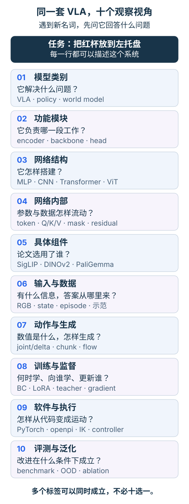
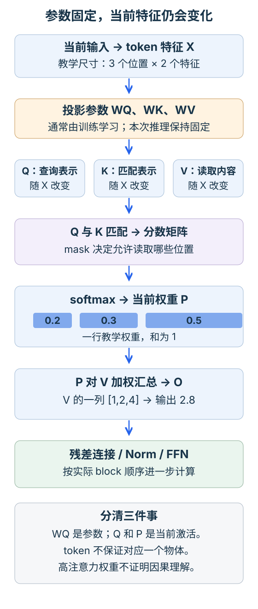
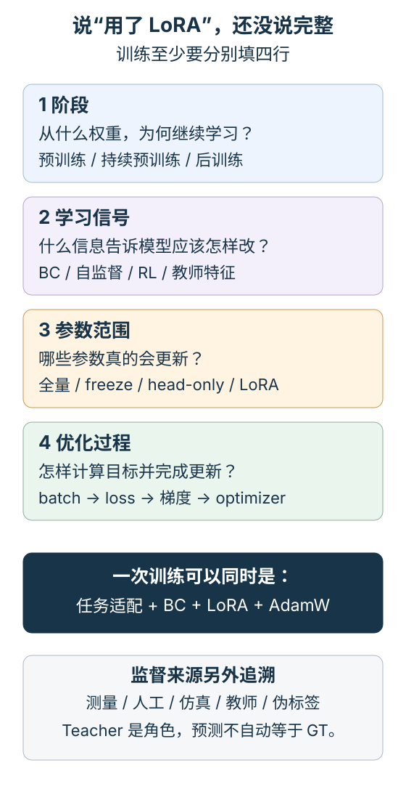

# VLA 概念地图：把每个新名词放回正确位置

**更新与来源核对：2026-11-15。** 按“它是什么、负责什么、怎样实现、怎样训练、怎样运行和怎样验证”组织知识。你可以把它当读论文时的索引，再沿链接进入详细课程。

先用一句话贯穿全页：**在“把红杯放到左托盘”的任务中，VLA 是一种策略模型；视觉编码器是功能模块；ViT 是网络结构；token 是表示单元；SigLIP 是现成组件；flow matching 是训练/生成方法；PyTorch 是软件框架；成功率是评测指标。** 它们描述同一个系统的不同方面，不是互斥选项。

<div class="vla-concepts" data-vla-concepts></div>

术语搜索与路径切换在构建后的文档站运行；GitHub 预览和禁用脚本时，仍可阅读下方完整图解、算例与自测。



## 先选一个问题，沿十个视角定位

| 视角 | 先问一句 | 常见名词 |
|---|---|---|
| [① 类别与职责](#axis-role) | 它解决哪一类问题？ | LLM、VLM、VLA、policy、agent、world model |
| [② 功能模块](#axis-modules) | 它在这条流水线里负责什么？ | encoder、projector、backbone、action expert |
| [③ 网络结构](#axis-architecture) | 这个模块怎样搭建？ | MLP、CNN、RNN、Transformer、ViT |
| [④ 网络内部](#axis-internals) | 里面流动和计算的是什么？ | tensor、token、embedding、Q/K/V、mask、参数 |
| [⑤ 具体组件](#axis-components) | 这篇论文选了哪一个现成模型？ | DINOv2、SigLIP、Gemma、PaliGemma |
| [⑥ 输入与数据](#axis-data) | 哪些信息可见，答案从哪里来？ | RGB、state、trajectory、episode、demonstration |
| [⑦ 动作与生成](#axis-actions) | 数字意味着什么，又怎样生成？ | joint、delta、chunk、autoregression、flow |
| [⑧ 训练与监督](#axis-training) | 在什么阶段、用什么信号、更新谁？ | pretraining、BC、LoRA、teacher、loss、gradient |
| [⑨ 软件与执行](#axis-execution) | 哪段代码怎样把参考变成运动？ | PyTorch、JAX、openpi、SDK、IK、controller |
| [⑩ 评测与泛化](#axis-evaluation) | 改进在哪些条件下成立？ | benchmark、success、OOD、ablation、Sim2Real |

十行是**并行的观察视角**，不是从上到下的继承树。一个 SigLIP 图像分支可以同时是视觉编码器、ViT 网络、预训练组件与 VLA 的一部分。遇到新名词时，先允许它有多个标签，再查它在当前论文中的具体接口。

第一次学习可先读 ①②⑤，建立整机概念；再读 ③④，理解结构图；最后用 ⑥⑦⑧⑨⑩ 把训练和实验串起来。不要一次记住全部缩写。

<a id="axis-role"></a>

## ① 类别与职责：它在解决什么问题？

AI、ML、DL 是逐步收窄的技术范围：机器学习是实现人工智能的一类方法，深度学习是其中采用多层神经网络的一类方法。当前主流 VLA 研究使用深度学习，但“AI”并不等于“某一种神经网络”。

| 名词 | 用红杯任务解释 | 应与什么区分？ |
|---|---|---|
| LLM，大语言模型 | 处理任务文字、生成语言或代码 | 能写计划不代表已经执行计划 |
| VLM，视觉语言模型 | 建立图文联系；有的生成描述，有的输出表征/相似度 | 可以生成文字或表征，不一定输出机器人动作 |
| VLA，视觉语言动作模型 | 以图像、语言等为条件生成动作 | 动作输出仍需明确物理合同与控制器 |
| Policy，策略 | 根据观测/历史等条件决定动作或动作分布 | 不使用语言的 CNN 策略同样是 policy |
| World model，世界模型 | 预测动作之后的状态、图像或其他环境结果 | 预测结果不等于已实际完成该运动 |
| Agent，智能体系统 | 组织观察、任务分解、模型/工具调用、执行与反馈 | 通常是系统层角色，可能调用多个模型 |
| Foundation model，基础模型 | 从广泛数据中学习可迁移能力，支持多种下游用途 | 描述训练与用途，不限定 CNN/Transformer 等结构 |

**同一系统可以组合这些职责。** 高层 VLM/LLM 选择“先抓红杯”，VLA 生成动作参考，世界模型辅助比较候选结果，agent 管理任务循环。这是一种可选设计，不是所有 VLA 必须具备的四件套。

RT-2 在 2023 年已明确使用 VLA 名称，OpenVLA 是后来的代表工作，不能把 OpenVLA 当作整个类别的起点。参见 [RT-2 原论文](https://arxiv.org/abs/2307.15818)。

**把名词放回去：**“这个 agent 用一个 VLM 做任务分解，并调用 VLA policy”表达系统组合；“VLM、agent、Transformer 三选一”则混合了类别、系统角色与结构。

继续：[VLA 核心概念](01-what-is-vla.md) · [世界模型课程](07-world-models-for-vla.md)。

<a id="axis-modules"></a>

## ② 功能模块：这块在流水线里负责什么？

```text
相机图像 → 视觉编码 ─┐
任务文字 → 文本表示 ─┼→ 条件融合/主干 → 动作生成
机器人状态 → 状态表示┘                    ↓
                        解码/逆变换 → 控制器 → 新观测
```

这是职责图。实际论文可以合并或省去部分模块；本体状态也不是所有模型都必须使用。

| 模块 | 输入 → 输出 | 用途与易错点 |
|---|---|---|
| Encoder，编码器 | 原始信息 → 特征表示 | 是功能名，不等于只能用 Transformer encoder |
| Vision encoder，视觉编码器 | 像素 → 视觉特征/token | 输出 token 不一定对应语义物体 |
| Text tokenizer，文本分词器 | 字符串 → token ID 与相关 mask | 编号不是已经获得意义的连续特征 |
| Embedding 层 | ID 等输入 → 向量 | 图像 patch 也可经线性投影获得 embedding，不必先有整数 ID |
| Projector，投影器 | 一种特征维度/布局 → 另一种表示 | 让接口接得上；维度对齐不等于物理或语义对齐 |
| Backbone，主干 | 条件特征 → 上下文特征 | 表示主要计算骨架；主干里仍包含多个子模块 |
| Fusion，多模态融合 | 多种模态 → 相互关联的表示 | 可以拼接、调制或注意力交互，具体方式看模型 |
| Head，输出头 | 中间特征 → 任务输出 | 可预测类别、连续数值、噪声或向量场 |
| Action expert，动作专家 | 条件与动作生成状态 → 动作相关预测 | 是专用网络模块，可以远比一层 Linear 复杂 |
| Controller，控制器 | 位置/速度/力等参考 → 实际执行响应 | 和模型动作头不处于同一软件/物理层级 |

**具体例子：**视觉特征宽度是 1,024，主干接收宽度是 2,048；projector 可以负责宽度变换。它不能仅凭宽度变化就把“相机坐标的米”变为“关节角的弧度”。后者还需要动作定义和机器人转换。

继续：[完整 VLA 系统图解](learning-core/09-vla-systems.md) · [多模态投影小节](knowledge-atlas/learning-transformers-multimodal/transformer-multimodal-projection/index.md)。

<a id="axis-architecture"></a>

## ③ 网络结构：这些功能怎样实现？

| 结构 | 核心计算直觉 | 在机器人系统中可能出现哪里？ |
|---|---|---|
| MLP，多层感知机 | 线性变换与非线性激活叠加 | 状态编码、特征投影、动作头、Transformer 的 FFN |
| CNN，卷积网络 | 共享卷积核处理局部区域；多层整合更大范围 | 视觉编码、触觉图编码 |
| RNN，循环网络 | 逐时刻更新隐藏状态 | 历史观测、在线时序处理 |
| LSTM / GRU | 带门控的 RNN 变体 | 控制历史与长期依赖的某些实现 |
| Transformer | 用注意力等模块处理 token 之间的依赖 | 视觉/语言主干、动作专家 |
| ViT，视觉 Transformer | 将图像分块并形成向量序列后用 Transformer 处理 | 视觉编码器的一类实现 |

还要用另一个角度描述 Transformer：encoder、decoder 和 encoder–decoder 区分网络组织与信息可见性；ViT 区分它怎样处理图像。**ViT 与 encoder/decoder 不是四个互斥兄弟类别。** 原始 ViT 使用 Transformer encoder，其他视觉模型可以有不同组织方式。

“MLP 与 Transformer 二选一”也不成立：Transformer block 通常含注意力与逐位置 FFN/MLP。将两层 MLP 用作 projector，同时用 Transformer 作为主干，是自然的组合。

**具体例子：**“用 ViT 实现视觉 encoder，用 MLP 投影，再用 decoder-style Transformer 处理条件序列”同时给出了功能模块和结构选择。它仍没有告诉你动作的单位、损失或训练数据。

原理来源：[Transformer 第 3 节](https://arxiv.org/html/1706.03762v7) · [ViT 原论文](https://arxiv.org/abs/2010.11929)。进一步读[表征与模型课](learning-core/04-representations.md)。

<a id="axis-internals"></a>

## ④ 网络内部：表示、参数和运算分别是什么？



### 4.1 Tensor、shape、patch、token 与 embedding

| 名词 | 最小解释 | 一个具体例子 |
|---|---|---|
| Tensor，张量 | 存放数值的多维数组 | 图像 `[B,3,H,W]`、动作 `[B,T,D]` |
| Shape，形状 | 各个轴的长度与排列 | `[2,3,224,224]` 是两张三通道图；不能仅凭数字推断 RGB/BGR |
| Patch，图像块 | 从图像划出的局部区域 | 28×28 图像用不重叠 14×14 patch，得到 4 块 |
| Token | 网络处理的一个序列位置/单元 | 文本子词、图像 patch、状态或动作生成位置 |
| Token ID | 离散词表中的编号 | 文本 tokenizer 将子词映射到整数 |
| Embedding | 把输入编码成向量，也可指产生向量的层 | 文本可查表；图像可经 patch 投影 |
| Hidden feature / state | 当前输入经中间层得到的表示 | 同一图像在第 2 层与第 12 层的特征不同 |

一个词可能被拆成多个文本 token；一个视觉 token 也不保证是一个物体。图片尺寸、patch、特殊 token、空间重采样和相机数共同影响视觉序列长度，不能从“有一个杯子”推断“有一个视觉 token”。

### 4.2 参数是保存下来的数，特征是这次输入算出来的数

采用行向量写法，最简单的线性变换为：

$$
Y=XW+b.
$$

教学形状：X 为 `[2,3,4]`，表示 2 个样本、每个 3 个位置、每位置 4 个特征；W 为 `[4,2]`，b 为 `[2]`，输出 Y 为 `[2,3,2]`。共享的 W、b 共 4×2+2=10 个可训练数，**不是每个样本各保存一套参数**。PyTorch `Linear` 将权重存为 `[out,in]` 并使用转置，不能把这个数学约定与库的存储约定混读。[官方 Linear 文档](https://docs.pytorch.org/docs/stable/generated/torch.nn.Linear.html)。

在通常不做在线学习的推理中，W、b 固定；换一张图，X 和 Y 都会变。冻结参数也不表示中间特征不再变化。

### 4.3 Attention：先匹配，再加权读取

简化的单头注意力可拆成三步：

1. 用可学习投影把特征变成 Q（query，查询）、K（key，匹配线索）、V（value，被读取的内容）。
2. 比较每个 Q 与各 K，加入可见性 mask，再对可见位置做 softmax。
3. 用所得权重加权汇总 V，形成当前位置的新特征。

$$
\begin{aligned}
Q&=XW_Q,\quad K=XW_K,\\
V&=XW_V,\\
S&=QK^{\mathsf T}/\sqrt{d_k},\\
P&=\operatorname{softmax}(S+M),\\
O&=PV.
\end{aligned}
$$

这里省略 batch、多头、偏置与输出投影。M 采用加法 mask：允许位置为 0，禁止位置为负无穷；每一查询行必须保留有效位置。W_Q、W_K、W_V 是参数；Q、K、V、P、O 都是随输入计算的激活。**attention 权重 P 不是一张独立保存、永远不变的参数表。**

- **Self-attention：**Q、K、V 来自同一组序列表示的投影。
- **Cross-attention：**Q 来自一组表示，K/V 来自另一组；例如动作查询读取视觉上下文。
- **Multi-head：**并行进行多组投影和读取，再合并；不是简单把同一张图复制多次。

**数字例子：**若一行权重是 `[0.2,0.3,0.5]`，对应单通道 V 为 `[1,2,4]`，输出就是 0.2×1+0.3×2+0.5×4=2.8。这里只展示加权读取，不表示这些位置分别对应一个物体，也不能用高权重直接证明模型“理解了红杯”。进入[注意力数值实验](32-vla-attention-lab.md)看参数固定时输入如何改变 Q/K/V 和权重。

### 4.4 四种 mask 不要混用

| mask | 解决什么问题？ | 不等于什么？ |
|---|---|---|
| Attention / causal mask | 限制 query 可以读取哪些位置，例如不能读未来 token | 不决定动作单位或损失是否统计 |
| Key padding mask | 让注意力忽略补齐的 key 位置 | 仍需按实现处理补齐 query 与输出 |
| Loss mask | 决定哪些目标位置/通道计入损失 | 不自动改变网络内部的信息可见性 |
| Segmentation mask | 标出图像的像素区域或物体区域 | 不是 Transformer 的注意力连接矩阵 |

不同 API 中布尔 `True` 可能表示“屏蔽”也可能表示“允许”，必须查调用接口；不要跨库复制 mask 后仅凭名字判定正确。原始 Transformer、π₀.₅ 等模型还采用各自的分块/前缀可见性设计，不能对所有 VLA 一律画成纯下三角。[PyTorch 注意力接口](https://docs.pytorch.org/docs/stable/generated/torch.nn.MultiheadAttention.html)。

### 4.5 Block 内部还有什么？

| 运算 | 做什么 | 易混点 |
|---|---|---|
| Linear | 特征的仿射变换 | 无激活时多次线性变换可合并，不自动获得复杂非线性 |
| Activation | 如 ReLU、GELU、SiLU，引入非线性 | 激活函数不等于“中间激活张量”这个更宽泛用法 |
| FFN / MLP | 对每个位置进一步做特征变换 | 位置间交换主要由注意力等部分完成 |
| Residual connection | 把分支输出加回输入，要求兼容形状 | 不是控制器额外施加的动作残差，也不是预测误差 |
| LayerNorm / RMSNorm | 按各自定义调整特征尺度 | 二者公式不同；不等于输入数据集的归一化 |
| Position encoding / RoPE | 提供位置/相对位置信息的实现 | 不会自动赋予机器人基座坐标系或物理米制语义 |

不同模型采用 pre-norm、post-norm、门控 MLP 等变体。读结构图时应查 Norm、注意力、残差和 FFN 的实际顺序，而不把一张教学框图当全部实现。

### 4.6 六个数量，分别回答六个问题

| 数量 | 本质问题 | 可以单独改变吗？ |
|---|---|---|
| 网络层数 | 重复多少层计算？ | 可以改深度，不等于修改输入序列长度 |
| 特征宽度 | 每个位置用多少个数表示？ | 改宽度常影响参数量，但不是同一个数 |
| Token 数 | 本次处理多少个位置？ | 改图片/文字长度可改变激活和计算，不必改变模型参数 |
| 参数量 | 保存多少可学习数值？ | 与当前 batch 内有几张图不同 |
| 动作维度 | 每个时刻输出几个通道？ | 可含位置、旋转、夹爪等，不等于关节数 |
| 机器人自由度 | 机器人有几个独立运动维度？ | 关节耦合和动作控制空间还需单独说明 |

**把名词放回去：**“7B 参数、576 个视觉 token、7 个动作通道、7 自由度手臂”是四份不同说明；数字相同也不能直接建立对应。

继续：[张量形状](knowledge-atlas/learning-transformers-multimodal/transformer-tensor-shapes/index.md) · [Q/K/V](knowledge-atlas/learning-transformers-multimodal/transformer-query-key-value/index.md) · [反向传播](learning-core/02-gradients.md)。

<a id="axis-components"></a>

## ⑤ 具体组件：论文究竟选了哪一个模型？

| 名称 | 通常放在哪一类？ | 接入 VLA 时核查什么？ |
|---|---|---|
| ResNet / EfficientNet | CNN 视觉模型家族 | 用哪一层特征，是否微调、输入预处理 |
| ViT | 视觉 Transformer 结构家族 | patch、分辨率、特殊 token 和输出特征 |
| DINOv2 | 自监督视觉预训练模型，采用 ViT | 具体大小、特征位置、训练/冻结策略 |
| CLIP / SigLIP | 图文表征预训练模型 | 使用图像分支还是完整双编码器，不要误画成生成式聊天模型 |
| Llama / Gemma | 语言模型家族 | 具体版本、宽度、tokenizer 和可训练模块 |
| PaliGemma / Qwen-VL | 视觉语言模型家族 | 具体 checkpoint、视觉塔和图文接口 |
| VGGT / OmniVGGT | 三维几何感知模型 | 输入 RGB/可选几何信息、输出几何或中间特征、是否仅作教师 |
| OpenVLA / π₀ / π₀.₅ | 具体 VLA 模型与配方 | 动作生成、数据、训练与部署接口 |
| SLA | 基于已有 VLA 的空间增强训练方案及所得模型 | 哪些监督/模块仅训练使用，哪些权重保留部署 |

这些名称处在不同抽象层。原始 [PaliGemma](https://arxiv.org/abs/2407.07726) 已组合 SigLIP 图像编码器和 Gemma 语言模型；如果说“采用 PaliGemma”，不能再把 SigLIP、Gemma 画成它旁边重复运行的三套完整模型。[DINOv2](https://arxiv.org/abs/2304.07193)与 [SigLIP](https://arxiv.org/abs/2303.15343)的预训练目标也不同。

OmniVGGT 可以接收可用的几何模态，但它作为某篇 VLA 的训练教师时，是否部署仍要看那篇方法。组件自己的输入能力不能自动变成学生策略的部署传感器要求。[OmniVGGT 原论文](https://arxiv.org/abs/2511.10560)。

继续：[22 条一手来源研究导读](30-vla-research-guide.md)；三个具体系统在[后面的对照](#three-models)中串起来。

<a id="axis-data"></a>

## ⑥ 输入与数据：可见信息与参考答案分开记录

### 模态决定“有什么信息”

| 输入 | 最小解释 | 本任务的作用 |
|---|---|---|
| RGB | 彩色图像 | 看红/蓝杯、托盘和相对位置 |
| Depth / RGB-D | 像素深度；或彩色与深度组合 | 几何估计，需说明标定与无效像素 |
| Point cloud | 带坐标的三维点集合 | 表示几何，需说明参考系和采样 |
| Language instruction | 任务文字 | 在相同场景下指定不同目标 |
| Proprioception | 关节、夹爪、末端等自身状态 | 区分图像相似但本体构型不同的情况 |
| History | 已发生的图像、状态、动作等 | 帮助估计运动、遮挡或任务阶段 |
| Force / tactile | 力、力矩与触觉测量 | 接触、载荷与滑移相关反馈 |

相机数量、时间窗口、深度和触觉不是 VLA 的统一硬性配置。尤其要区分“训练教师有深度”“策略部署有深度”和“策略自己预测深度”。

### 数据组织决定“怎样配成学习样本”

```text
单步：观测 + 条件 + 对应动作
  → 连续序列：trajectory
  → 一次带重置/终止边界的交互：episode
  → 用作学习示范：demonstration
  → 数据集：多条记录及其版本/元数据
```

这些不是严格的单向继承关系：一段 demonstration 可以包含一条完整 episode，也可以是经过说明的片段；dataset 还可能包含失败、干预或其他监督记录。

遥操作是获得示范的一种方式，机器人自动生成、专家规划器和人类视频转换也可能提供数据。人类视频通常没有目标机器人电机命令，必须记录姿态恢复、重定向、执行与筛选各环节的来源。

**具体例子：**相机在 0.98 秒曝光、1.03 秒才被程序读到；1.00 秒决策的动作不能把它当作在线已可见输入。未来动作可以做监督标签，未来图像不能偷偷混入当前输入。

数据增强可能改变左右含义或坐标；只翻图不改动作可能破坏监督。归一化统计只用允许的训练数据拟合；按 episode、物体或场景隔离留出，不能随机拆相邻帧后声称新场景泛化。继续：[完整数据指南](21-vla-dataset-organization.md)。

<a id="axis-actions"></a>

## ⑦ 动作表示与生成：先问“是什么”，再问“怎么算”

### A. 物理表示描述输出含义

| 选择 | 例子 | 必须附带的合同 |
|---|---|---|
| Joint action | 关节目标、速度或力矩 | 顺序、单位、零位、耦合、控制模式 |
| End-effector action | 末端位置、姿态或其增量 | 基座/工具参考系、旋转表示与合成方式 |
| Gripper action | 开度、宽度或二元开闭 | 夹爪极性、绝对/增量、单位 |
| Absolute / delta | 到达 x=0.1m / 向+x移动0.01m | 相对当前实测还是旧目标，在哪个采样间隔应用 |
| Rotation representation | 欧拉角、四元数、旋转向量等 | 顺序、归一化、周期与损失定义 |
| Action chunk | `[H,D]` 的未来动作序列 | 预测 H、执行前缀 K、时间间隔和 mask |

### B. 生成方法描述如何计算这些输出

| 生成路线 | 训练/推理直觉 | 不应推出的结论 |
|---|---|---|
| Regression | 直接回归连续数值 | MSE 与 L1 的统计目标不同；单一输出未完整描述多峰分布 |
| Autoregressive | 按条件概率依次生成 token | token 可以编码一个块；不一定一关节一个 token |
| Diffusion | 按训练噪声过程与采样器逐步生成动作 | 不是随意反复“减噪声”；步数和调度器必须匹配 |
| Flow matching | 拟合概率路径的速度场，积分生成动作 | 插值时间不是机器人运行时间，也不天然保证更快 |

**结构与生成可以组合。** Transformer 可以参数化回归头、扩散去噪器或流匹配向量场。动作生成网络内部处理“动作 token/embedding”，也不必代表动作在外部词表中被离散化了。

**具体例子：**20Hz 动作间隔、H=16、K=4，只说明标称预测 0.8s、执行前缀 0.2s；还须加入推理等待和重规划规则。若输出归一化 0.5，训练范围是 ±20mm，仿射逆变换得到 +10mm；这个数字仍不是关节角。进入[动作合同交互](learning-lab-cn.md#vla)，再读[动作表示与 Tokenization](24-action-representation-and-tokenization.md)。

<a id="axis-training"></a>

## ⑧ 训练与监督：把四条轴分别填完



“π₀.₅ 上做 LoRA 行为克隆”一句话还不完整。至少需要分清以下四条轴：

| 轴 | 问题 | 例子 |
|---|---|---|
| 阶段 | 从哪份权重出发，为哪个用途继续学习？ | 预训练、持续预训练、后训练、任务适配 |
| 学习信号 | 什么信息告诉模型应该怎样改？ | 行为克隆、自监督、RL、教师输出/特征 |
| 参数范围 | 哪些参数会更新？ | 全量、冻结某些模块、仅动作头、LoRA |
| 优化过程 | 怎样形成损失、算梯度、更新？ | batch、mask、loss、反传、AdamW、学习率 |

### 8.1 阶段不限定学习方法

预训练建立较广泛能力；持续预训练从已有权重继续利用新数据；后训练进一步适配目标用途。Fine-tuning 是从已有权重继续训练的常见方式，可以发生在不同适配阶段。不同论文命名边界并不完全相同，应抄下其数据、目标与初始化定义。

网络结构可以保持不变而权重改变。后训练可以使用监督、纠正数据或 RL；“后训练”不是“强化学习”的同义词。

### 8.2 学习信号不等于参数更新策略

| 方法 | 提供学习信号的方式 |
|---|---|
| Supervised learning | 用指定标签/目标构造监督 |
| Behavior cloning，BC | 对示范观测预测示范动作，是常见模仿学习路线 |
| Imitation learning，IL | 从专家行为信息学习；范围比普通逐步 BC 更广 |
| Self-supervised learning | 从数据本身构造目标，常不需人工逐项标注 |
| Reinforcement learning，RL | 用交互反馈、奖励与相应目标改进策略 |
| Distillation，蒸馏 | 学习教师输出、分布或特征等信号 |

它们可能组合。行为克隆也可用 token 交叉熵、L1、扩散或流目标；“是 BC”不能推断具体动作头。蒸馏也不要求教师与学生使用同一结构。

### 8.3 Freeze、PEFT、LoRA 分别冻结/训练谁？

冻结是指定参数保持不变；全量微调通常更新整个模型中计划训练的参数；PEFT 是减少可训练参数的方法类别。LoRA 为选定权重增加低秩更新，所选原权重保持冻结，其他动作头、归一化或模块是否训练取决于配置。

$$
W'=W+AB.
$$

若 W 为 `[1000,1000]`，低秩 r=4，A 为 `[1000,4]`、B 为 `[4,1000]`，额外参数共 8,000，而 W 有 1,000,000。这里与[注意力实验](32-vla-attention-lab.md)统一采用行向量变换的约定，AB 与原 W 形状一致。省略缩放系数，**只计算这一矩阵**；激活、其他模块、梯度与优化器仍耗资源，不能把 8,000/1,000,000 当作整模型显存比例。参见 [LoRA 原论文](https://arxiv.org/abs/2106.09685)。

### 8.4 损失、反向传播与优化器是不同步骤

```text
读取 batch、形成有效 mask
 → 前向得到预测
 → 按目标与mask计算loss
 → backward计算梯度
 → optimizer使用梯度更新参数
 → 保存配置、日志与checkpoint
```

Loss 是训练目标的标量结果；梯度是它对参数的局部变化率。普通梯度下降沿负梯度尝试减小损失，AdamW 等优化器还使用自己的状态和规则；不能把“梯度”本身直接定义为下降方向。

Batch 是共同处理的一组样本；microbatch 可以因梯度累计分多次前向/反传；一次 optimizer step 才执行参数更新。日志中的 step 可能指微批次或更新步，必须核对。Epoch 表示遍历一份数据的约定；流式/重采样训练也可能主要按步数记预算。

L1、MSE、token 交叉熵和 flow 目标并非同一量纲；跨方法比较 loss 数值，不能直接判断谁的机器人能力更好。继续：[梯度](learning-core/02-gradients.md)、[训练工程](learning-core/03-training.md)、[模仿学习](learning-core/05-imitation.md)与[微调手册](28-smolvla-gpu-finetuning-runbook.md)。

### 8.5 Teacher 是角色，GT 必须追问来源

| 参考信息 | 来源 | 应写明的限制 |
|---|---|---|
| 传感器测量 | 相机、力传感器等 | 标定、噪声、时延和失效条件 |
| 人工标注 | 人给的类别、框或动作标签 | 标注协议与一致性 |
| 仿真状态 | 模拟器内部状态 | 取决于仿真模型，不是实物测量 |
| 教师预测 | 一个已训练模型的输出/特征 | 预测/表征目标不自动成为真实物理真值 |
| 伪标签 | 算法产生并当作标签使用的结果 | 算法、置信条件与错误传播 |

论文里的 GT 可能指其任务约定的参考标签，并不自动代表无噪声测量。记录“谁产生、训练时是否可见、部署时是否可得”，比只抄 GT 三个字更重要。

<a id="axis-execution"></a>

## ⑨ 软件与机器人执行：结构图怎样落到代码？

| 层级 | 名称 | 作用 |
|---|---|---|
| 数值与自动微分 | NumPy、PyTorch、JAX | 数组计算；后两者还用于实现自动微分与模型执行等 |
| 机器人学习项目 | openpi、LeRobot | 发布/组织策略、数据、训练与推理代码 |
| 配置与产物 | Config、checkpoint | 配置结构/超参数；保存权重及可能的训练状态 |
| 机器人通信 | SDK / API | 发送约定命令、读取状态和处理错误 |
| 坐标与运动学 | frame、calibration、FK、IK | 坐标关系、传感器/外参、关节与末端转换 |
| 低层执行 | Controller、servo | 跟踪目标，处理实际动态响应 |
| 系统调度 | Closed loop、latency、queue | 重新观测、等待、动作时效和块切换 |

PyTorch 不是 Transformer 的一种，openpi 也不是与 π₀.₅ 并列的单个模型。相同算法可以用不同软件实现，同一软件也能实现不同算法。[openpi 官方仓库](https://github.com/Physical-Intelligence/openpi)。

学习率、网络宽度等是配置/超参数，权重通常由训练优化；相机名、单位和关节顺序也是配置的一部分，不能因它们不是学习参数就忽略。checkpoint 目录存在，只能先确认产物存在，还要验证重载、处理器、统计量和输出一致性。

**具体例子：**末端增量先需解释参考系、逆归一化和旋转，再交给对应控制器；需要时经 IK 求关节参考。模型每秒生成几次、块内每秒发送几个动作、传感器频率与电机伺服频率分别记录。闭环表示根据新反馈更新，不只是把预先生成的数组播放完。

继续：[模型接口](23-robot-foundation-models.md) · [部署与时间测量](20-vla-deployment-guide.md) · [坐标系基础](foundations/05-coordinate-transform.md)。

<a id="axis-evaluation"></a>

## ⑩ 评测与泛化：改善结论成立到哪里？

| 名词 | 它回答什么？ | 常见误读 |
|---|---|---|
| Dataset | 有哪些训练/评测记录？ | 数据集名称不等于完整评测协议 |
| Simulator | 怎样计算物理、传感与渲染？ | MuJoCo/Isaac Sim 等工具不是一组固定任务 |
| Benchmark | 用哪些任务、初态、执行方式和评分规则比较？ | 同名任务仍可能配置不同 |
| Train / validation / test | 学习、调参/选择和最终留出各用什么？ | 测试结果不能反复用于选择模型后仍称独立测试 |
| Success rate | 满足完整成功条件的回合占比 | 要有分子、分母、终止/干预规则与不确定性 |
| Progress / score | 达成多少步骤或得分？ | 进度分不一定是完整任务成功率 |
| ID / OOD | 相对哪份训练分布，改变了什么？ | 新位置、新物体、新本体不是同一种泛化 |
| Zero-shot / few-shot | 目标域是否提供适配样本/更新？ | 要声明预训练是否已见相关任务及“shot”的单位 |
| Ablation | 移除/替换设计后结论如何变化？ | 同时换数据、预算和骨干无法单独归因 |
| SOTA | 在指定协议下与哪些基线比较领先？ | 不是所有机器人和全部任务的永久排名 |
| Sim2Real | 仿真得到的策略/信息怎样迁移到实物？ | 仿真成功不能自动成为真机成功 |

**具体例子：**40 次留出任务中，36 次抓住但只有 24 次放稳并释放。如果成功定义是完整放置，结果是 24/40=60%；90% 只能描述“抓住”这一阶段。随机种子帮助复现随机过程，但不消除环境分布变化或相关样本问题。

公平比较至少固定或明确报告任务、初态、训练数据、预训练来源、训练/推理预算、控制合同、人工干预和统计方式。观察到离线 loss 低而闭环失败，不足以单独证明过拟合，还需排查时间、动作解码、状态覆盖与评测器。[统一评估课程](foundations/14-evaluation-and-reproducibility.md)。

<a id="three-models"></a>

## 三个例子：把十个视角连接起来

下面是来源核对过的简化路径，用来定位名词，不代替完整架构或复现实验。每条路径后都要继续核对 checkpoint、数据与控制器。

### 原始 OpenVLA：组件、模块与生成方式同时出现

```text
图像 → DINOv2 + SigLIP 的融合视觉特征
    → projector → 与语言表示进入 Llama 2 主干
    → 自回归动作 token → 解码/逆变换 → 机器人动作参考
```

| 视角 | 这条路径中的对应项 |
|---|---|
| 类别/功能 | VLA policy；视觉编码、投影、主干、动作解码 |
| 结构/组件 | ViT 视觉分支、MLP projector、Llama 2 Transformer |
| 表示/生成 | 视觉和语言表示；每通道离散动作编码、自回归生成 |
| 训练/执行 | 机器人动作 token 的交叉熵训练；执行前核对末端动作合同 |

“DINOv2”与“视觉编码器”分别给出具体选型和功能；“自回归”说明动作生成。“7B”是参数量，不能用来解释动作维度。来源：[OpenVLA 第 3 节](https://arxiv.org/html/2406.09246v3)。

### π₀.₅：VLM 组件内部已经包含视觉与语言分支

```text
原论文的高层过程：观测 + 总体任务 → 预测语义子任务
                         ↓
低层：图像 + 子任务条件 + 本体状态表示
   → PaliGemma 条件主干，与较小的动作专家交互
   → flow向量场 → 连续动作块 → 控制器
```

| 容易漏掉的细节 | 应怎样理解？ |
|---|---|
| PaliGemma | 已有 SigLIP 视觉部分和 Gemma 语言部分，不是再并排加两套重复主干 |
| 本体状态 | 原论文将其离散化为文本 token 形式；不能据一般教学图推断必为独立 MLP 输入 |
| 训练动作表示 | 原论文共同使用 FAST 离散动作与连续 flow 路径，两者的信息可见性由 mask 设计 |
| 低层条件 | 原论文还包括预测的语义子任务，不能只描述“总指令直接到动作” |
| 公开代码 | openpi 当前说明 π₀.₅ 训练/推理支持 flow 头，不能把论文全部目标当作已开放实现 |

原论文架构与附录 A-E、公开仓库分别核对：[π₀.₅ v1](https://arxiv.org/html/2504.16054v1) · [openpi 模型列表](https://github.com/Physical-Intelligence/openpi)。

### SLA：改训练监督，不等于部署新增一套三维传感器

```text
训练时的两条路径
 RGB + 指令 + 状态 → 从π₀.₅初始化的VLA → 动作监督
 多视角RGB + 可用几何信息 → 冻结OmniVGGT → 空间表征目标
 VLA中间视觉特征 → 归一化/投影/层门控 → 与空间目标对齐

部署时
 原VLA观测接口 → 训练后的VLA权重 → 动作
 辅助教师、投影与门控不再用于推理
```

教师使用可用的深度、相机内外参与 RGB；产生的空间特征是模型监督目标，不能称为直接测得的三维真值。对齐发生在中间视觉特征，动作标签仍有自己的来源和目标。冻结教师不代表学生被冻结；保留原推理架构也不代表训练后的权重没有变化。

SLA 属于已有 VLA 的持续预训练/后训练设计与所得策略；其空间教师是具体组件、层门控是训练时模块、辅助对齐是学习目标，三者可以同时定位。[SLA 方法 §3.2](https://arxiv.org/html/2611.08373v1)。

## 自测：把一句话拆成不同层次

<details markdown="1">
<summary>一：“用 PyTorch 实现 Transformer，冻结视觉塔，用 LoRA 训练动作策略”中，四个名词各在哪个视角？</summary>

PyTorch 属于软件框架；Transformer 是网络结构；视觉塔是功能模块；冻结和 LoRA 描述参数更新范围。还没有说明是 BC 还是 RL、动作是什么单位、采用哪份训练数据、在哪个 benchmark 评估。LoRA 只限定被选权重的更新形式，其他模块是否训练仍要查配置。

</details>

<details markdown="1">
<summary>二：冻结 W_Q 后，换一张图片，Q 和 attention 权重是否也必须不变？</summary>

不必。Q = XW_Q，输入特征 X 改变后，Q 及后续匹配分数、softmax 权重都可能改变。被冻结的是参数 W_Q，不是激活 Q。注意力实验中保持参数固定、只改输入，就能检验这一区别。

</details>

<details markdown="1">
<summary>三：SLA 训练教师使用深度，能否据此说部署策略必须接深度相机？</summary>

不能。先查训练/部署信息路径。SLA 的辅助教师、投影与门控仅训练使用，原论文保留原 VLA 推理架构。还应分别记录教师输入、学生输入、动作标签和空间目标来源；教师预测不自动等于物理 GT。

</details>

## 学习验收：给新论文填写一页十维卡

选一篇尚未熟悉的 VLA 工作，为十个视角各填一行；无法从公开资料确认的字段写“未说明”，不要猜测。

1. 给出问题、模型职责和整体数据路径，标明训练专用支路。
2. 选一个功能模块，补上结构、具体模型名、输入输出 shape。
3. 区分其可学习参数、当前激活、attention/loss mask；用[数值实验](32-vla-attention-lab.md)完成一次固定参数、改变输入的预测。
4. 分别填写训练阶段、监督来源、参数范围与优化过程，明确 teacher/标签的来源。
5. 填动作合同、执行时序与评测协议；把离线指标、分阶段结果和完整任务成功分别记录。

继续：[VLA 系统课](learning-core/09-vla-systems.md) · [注意力实验](32-vla-attention-lab.md) · [研究导读](30-vla-research-guide.md) · [VLA 专项](specializations/vla-zero-to-one-cn.md)。

本页核查了上述原论文的指定结构/方法段、官方模型说明与软件接口。教学数字用于说明概念，没有新增模型训练、论文指标复算或机器人运行证据。正文属于学习导航，不是给所有 VLA 规定统一实现。

本轮实现与检查范围见[概念地图验证记录](reviews/vla-concepts-2026-11-15.md)。
