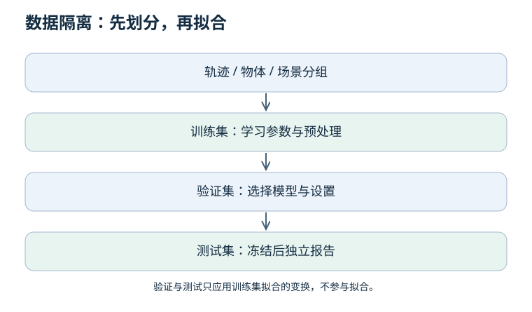

# 01 · 机器学习：从样本到可检验的规律

[课程入口](README.md) · 下一章：[梯度与反传](02-gradients.md)

先修：数组、平均数、函数。学完要能定义样本、区分训练与泛化，并设计没有信息泄漏的数据划分。

## 1. 先看整个过程

监督学习不是把答案“存进网络”，而是寻找一个带参数的函数，使它在来自目标分布的新输入上也有用。我们只能观察有限样本，因此训练误差只是证据的一部分。

| 小知识点 | 含义 | 机器人中的例子 |
| --- | --- | --- |
| 样本与标签 | 输入及其监督目标 | 一张图像与对应抓取位置 |
| 特征 | 用来做预测的输入表达 | 像素、关节角、末端速度 |
| 参数 | 从训练数据学到的数 | 线性层权重、偏置 |
| 超参数 | 训练前或验证阶段选择的设置 | 学习率、网络宽度 |
| 回归 | 预测连续量 | 关节增量，单位为弧度 |
| 分类 | 预测离散类别的分布 | 接触/未接触 |
| 泛化 | 对目标分布新样本的表现 | 未参与训练的物体与轨迹 |

分类概率不等于可靠置信度；神经网络也可能在陌生输入上过度自信。回归值不自动满足机械限位。

### 监督、自监督、无监督与强化学习

- **监督学习**：使用给定的目标标签，如图像对应的专家动作。
- **自监督学习**：从数据本身构造目标，如遮住图像的一部分再重建，或从过去预测未来；仍然有损失和监督信号，只是不依赖逐样本人工作标签。
- **无监督学习**：常指聚类、密度估计等从无任务标签数据中发现结构的方法；与自监督的术语边界在文献中有交叉。
- **强化学习**：利用序贯交互的奖励优化回报，不是给每一步直接提供正确动作。

“预训练”描述训练阶段，“自监督”描述信号来源，两者不是同义词。预训练可以有人工标签；自监督也可能只在小数据上进行。

## 2. 损失、经验风险与真实目标

设模型为 fθ，单样本损失为 ℓ。经验风险是训练集上损失的平均值；总体风险则是目标分布下损失的期望。有限数据、分布变化和测量噪声会使两者不同。

手算一个无偏置回归模型：预测 ŷ = wx。训练样本是 (1, 2)、(2, 4)。当 w = 1 时，均方误差为 ((1−2)² + (2−4)²)/2 = 2.5；当 w = 2 时为 0。

这只说明两个训练点被拟合。若测试标签遵循 y = 3x，训练损失为零仍会失败。必须说明部署分布是什么，而不是只说“模型很准”。

## 3. 数据划分为什么比换模型更早？

相邻视频帧高度相关。把同一轨迹随机拆到训练与测试中，会让测试看起来像“见过的场景”。划分单位应由问题决定：要测试新物体就按物体分组；要测试新操作者就按操作者分组。仅按轨迹分组也不能证明新物体泛化。

先划分，再在训练集上拟合均值、标准差、词表和特征选择。验证与测试只应用这些已经固定的变换。多次根据测试结果改模型，也是在间接使用测试信息。

算例：训练输入 [0, 2] 的均值为 1，标准差为 1（总体标准差）。留出输入 100 应变换成 99，而不是为了“让它正常”把 100 算进均值。99 提醒你发生了分布偏移，不意味着应该偷偷重新拟合。

## 4. 欠拟合、过拟合与偏移不是一回事

| 现象 | 候选原因 | 下一步检查 |
| --- | --- | --- |
| 训练与验证都差 | 容量不足、特征不足、优化失败、标签错 | 先尝试拟合极小数据集 |
| 训练好、验证差 | 过拟合或划分分布不同 | 比较输入范围、标签质量与曲线 |
| 离线好、闭环差 | 动作反馈改变状态分布 | 查看失败前访问的状态 |
| 只在一种物体上好 | 覆盖不足或背景捷径 | 换物体、背景和初始位置 |

偏差—方差分解通常在平方损失及指定随机性下讨论，不是所有模型失败的万能分类法。更多数据只有在质量、覆盖和目标分布相关时才有帮助。

### 类别不平衡：准确率为什么会骗人？

100 个样本中只有 5 个发生危险接触，永远预测“无危险”也有 95% 准确率，但危险召回率为 0。召回率是 TP/(TP+FN)，精确率是 TP/(TP+FP)，其中 TP 是正确报警数、FN 是漏报数、FP 是误报数。

假设正确报警 4 次、漏报 1 次、误报 6 次，召回率为 4/5 = 80%，精确率为 4/10 = 40%。阈值要根据漏报与误报代价在验证集选择，不能用测试标签调阈值。分母为零时需事先约定指标处理，而非随意写成满分。

## 5. 自测与答案

同一轨迹的奇数帧训练、偶数帧测试，可以证明新轨迹泛化吗？

不能。两侧可能共享物体、背景和几乎相同的状态。应先按轨迹或更严格的目标泛化单位划分，再切片；说明测试所覆盖与未覆盖的变化。

训练误差为零，却在测试上很差，应该立即增大模型吗？

不应。先查划分、预处理、标签和分布差异。训练误差已经为零，并不支持“容量不足”的诊断。

## 6. 实践验收

运行 [离线实验](README.md#一个不需要-gpu-的实验入口) 的数据隔离部分。写出训练/验证/测试的分组单位、用途，以及禁止跨集合共享的拟合步骤。验收不是固定比例，而是无重叠、无泄漏，并匹配研究问题。

原始资料：[scikit-learn 数据泄漏与预处理说明](https://scikit-learn.org/stable/common_pitfalls.html)。下一章把“拟合参数”展开成可以手算的梯度更新。
