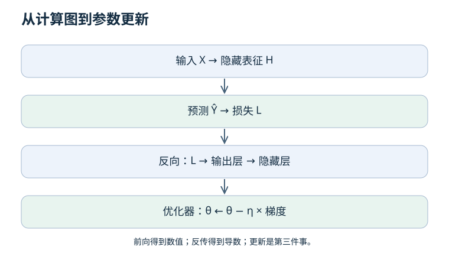

# 02 · 梯度与反传：一次更新到底发生了什么？

上一章：[机器学习](01-machine-learning.md) · 下一章：[训练工程](03-training.md)

先修：函数、导数、矩阵乘法。目标：手算梯度，理解反传顺序，检查张量尺寸与实现是否一致。

## 1. 把四件事分开

**前向传播**计算预测；**损失函数**比较预测与目标；**反向传播**用链式法则计算导数；**优化器**根据导数更新参数。调用 backward 本身并不更新权重。

梯度是当前点的局部变化率，不是全局最优方向保证。学习率过大时，沿负梯度走也可能让损失上升。

## 2. 一次可手算的更新

模型 ŷ = wx + b，单样本损失 L = (ŷ − y)²/2。给定 x = 2、y = 5、w = 1、b = 0。

1. 前向：ŷ = 2，误差 e = −3，L = 4.5。
2. 损失对预测的导数：dL/dŷ = e = −3。
3. 预测对 w 的导数为 x = 2，所以 dL/dw = −6；对 b 的导数为 1，所以 dL/db = −3。
4. 学习率 0.1：新 w = 1.6，新 b = 0.3。
5. 新预测为 3.5，新损失为 1.125，确实下降。

注意：这里损失含 1/2；不含 1/2 的平方损失会多一个系数 2。比较梯度前先对齐损失定义和平均维度。

## 3. 两层网络与尺寸检查

| 变量 | 尺寸 | 含义 |
| --- | --- | --- |
| X | B × D | 一批 B 个 D 维输入 |
| W1、b1 | D × M、M | 第一层参数 |
| Z = XW1 + b1 | B × M | 广播偏置后的中间量 |
| H = tanh(Z) | B × M | 非线性隐藏表征 |
| W2、b2 | M × A、A | 输出层参数 |
| Ŷ = HW2 + b2 | B × A | A 维连续预测 |

若 L 是全部 B×A 个误差平方的均值，则输出梯度 G = 2(Ŷ−Y)/(BA)。接着 dW2 = HᵀG；dH = GW2ᵀ；dZ = dH ⊙ (1−H²)；dW1 = XᵀdZ。偏置梯度沿 batch 维求和。

这里 ⊙ 是逐元素相乘，不能写成矩阵乘法。参数梯度必须与对应参数同形状。自动求导省掉手工计算，但不会替你发现标签顺序错了。

## 4. 分类为什么要区分 logits 与概率？

Logits 是任意实数打分；softmax 将它们转换为和为 1 的概率。正确类别概率为 0.8 时，负对数似然约为 0.223；概率为 0.2 时约为 1.609（自然对数）。

稳定的实现通常把 log-softmax 与负对数似然合并。如果接口要求 logits，就不要先做 softmax 再传入同一个接口；否则计算的不是你以为的损失。标签类型、类别轴和忽略填充位置也必须与接口一致。

## 5. 有限差分：为反传做一次体检

将单个参数 θ 分别增加和减少 ε，近似导数为 [L(θ+ε)−L(θ−ε)]/(2ε)。用 float64、小网络、固定输入和无随机操作做检查。

ε 太大带来截断误差，太小会放大舍入误差。ReLU 在零点不可微，不适合在该点要求左右差分匹配。梯度检查通过只证明检查点附近的导数实现，不证明整个任务正确。

如果代码忘记对 batch 求平均，扩大 batch 后会怎样？

若实际采用求和损失而学习率不变，梯度尺度通常随样本数改变，更新幅度也变了。先核对 reduction，再比较训练曲线。

为什么每次常规更新前要清空梯度？

常见自动求导系统会累加梯度。若不是有意做梯度累积，就会把先前 batch 的贡献再次用于更新。有意累积时还要对齐损失缩放和更新频率。

## 6. 实践验收

[离线实验](README.md#一个不需要-gpu-的实验入口) 包含 NumPy 手写两层网络。先检查每类参数的解析梯度，再训练。故意移除 tanh 导数中的平方，确认测试能抓住错误；不要把这个故障版本提交为正常代码。

参考：[Stanford CS231n 计算图与反向传播](https://cs231n.github.io/optimization-2/)。
