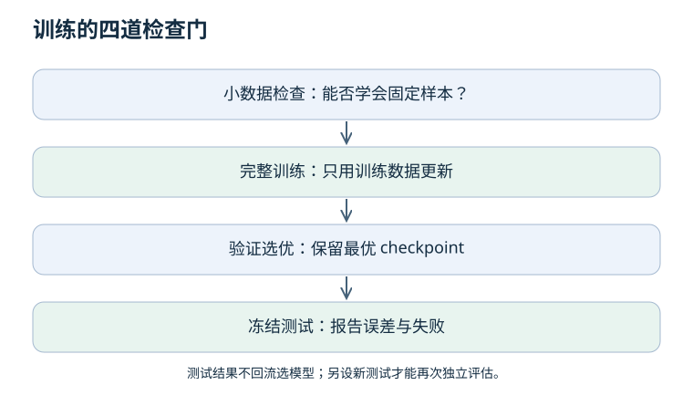

# 03 · 训练工程：让一次结果能够被解释和重现

上一章：[梯度与反传](02-gradients.md) · 下一章：[表征与模型](04-representations.md)

先修：梯度更新、数据划分。目标：读懂训练循环，区分优化失败与泛化失败，并保存足够的复现信息。



## 1. Batch、step、epoch 与梯度累积

Batch 是一次送入网络的样本集合；优化 step 是一次参数更新；epoch 是遍历一次训练数据。它们不是同义词。

例：1,000 个样本、batch 100、不丢弃样本、无累积，每个 epoch 有 10 次更新。如果累积 2 个 batch 再更新，则有 5 次更新。改变 batch 后，“训练 50 epoch”不保证与原来有相同更新次数。

记录学习率计划按 step 还是 epoch 推进。多设备或累积训练中，要明确有效 batch 和损失归一化，而不是只报每张卡的 batch。

## 2. 训练循环的必要条件

```text
按训练划分取 batch → 应用训练集拟合的预处理
切到训练模式 → 清梯度 → 前向 → 检查有限损失
反传 → 按需要裁剪梯度 → 优化器更新 → 按约定推进学习率
定期切到评估模式 → 关闭梯度记录 → 统计完整验证集
保存验证最优模型与复现信息；最后使用一次冻结测试集
```

关闭梯度记录与切换评估模式是两件事：前者减少求导开销，后者影响 Dropout、BatchNorm 等层的行为。恢复训练前记得切回训练模式。

## 3. 优化器与正则化：不要靠默认值理解

| 方法 | 做什么 | 容易误会什么 |
| --- | --- | --- |
| SGD | 按梯度更新，可带动量 | 不是一定比 Adam 差 |
| Adam | 利用梯度一阶、二阶矩估计缩放更新 | 仍需调整学习率等设置 |
| AdamW | 将权重衰减与自适应梯度更新解耦 | 不等同于给 Adam 的 loss 加 L2 |
| Dropout | 训练时随机屏蔽部分激活 | 推理时通常关闭，不能忘记评估模式 |
| 早停 | 按验证指标、容忍次数选择停止点 | 不是验证 loss 抖动一次就停止 |
| 数据增强 | 施加仍保持监督关系成立的变化 | 图像翻转后机器人动作未必仍正确 |

在普通 SGD 的特定系数约定下，L2 惩罚与乘性权重衰减可以对应；自适应优化器中的缩放改变了这种对应关系。查阅 [AdamW 原论文](https://arxiv.org/abs/1711.05101)，不要将结论推广成“所有网络都必须用 AdamW”。

## 4. 一个学习曲线算例

假设连续三次验证时，训练 loss 为 0.8、0.3、0.1；验证 loss 为 0.9、0.5、0.7。按验证 loss 选第二次 checkpoint，而不是最后一次。

但若最终目标是成功率，还应同时检查闭环指标：动作 MSE 不一定与成功率单调一致。不能在看到测试成功率后重新选择“最优”checkpoint，再把同一测试集叫作独立测试。

## 5. 从最便宜的故障开始查

| 故障 | 优先排查 | 不应立即下的结论 |
| --- | --- | --- |
| loss 不动 | 参数是否参与优化、标签是否匹配、梯度是否为零 | “数据太少” |
| loss 为 NaN | 输入有限性、除零、log、梯度、精度与步长 | “模型太小” |
| loss 降得快但闭环失败 | 动作单位、时序对齐、覆盖、评估泄漏 | “加 epoch 就好” |
| 换 seed 差异大 | 样本量、划分、方差、初始化与任务难度 | “选最好 seed 发布” |

先尝试拟合 8–32 个固定样本，这是检查实现是否能学的诊断，不是性能证据。随后才恢复合理划分、增强和正则化。

<details>
<summary>同一随机种子能保证不同机器逐位一致吗？</summary>

不能。还涉及算子确定性、硬件、库版本、并行顺序和数据加载。应报告环境与多个种子的分布，而不是仅给种子编号。

</details>

<details>
<summary>从 checkpoint 恢复训练，只读模型权重足够吗？</summary>

若要求继续同一训练轨迹，通常还需要优化器、学习率计划、随机数状态、训练进度与数据迭代状态。只读权重可以继续学习，但不应声称精确续跑。

</details>

## 6. 实践验收

为 [离线网络实验](README.md#一个不需要-gpu-的实验入口) 记录 seed、输入维度、loss 定义、学习率、更新次数和最终误差。改变学习率后先预测曲线，再运行。提交原始结果与解释，不删除表现不佳的设置。
