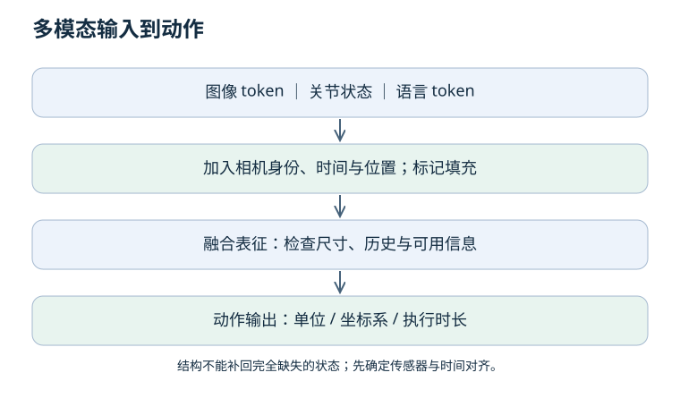

# 04 · 表征与模型：为什么不能只堆网络层？

上一章：[训练工程](03-training.md) · 下一章：[模仿学习](05-imitation.md)

先修：矩阵尺寸、两层网络。目标：把相机、关节和语言组织成有时序与单位约定的输入，解释模型选择。

## 1. 表征不是世界本身

表征是保留任务相关信息的表达。单张图像可以看到物体位置，却不一定能判断速度、遮挡后的接触或被遮住的手指。模型再大也无法从完全相同的可见输入中确定隐藏状态；需要历史、其他传感器或对不确定性的建模。

| 模型 | 主要结构假设 | 适合的起点 | 限制 |
| --- | --- | --- | --- |
| MLP | 固定长度向量的非线性映射 | 低维关节、状态基线 | 不显式利用像素邻域 |
| CNN | 局部连接与共享卷积核 | 图像空间结构 | 位移等变受边界、步长等影响 |
| RNN | 通过隐藏状态逐步传递历史 | 顺序传感器流 | 长期依赖与并行训练有挑战 |
| Transformer | token 间内容相关的加权交互 | 多模态或时序融合 | 需组织位置、遮罩与计算预算 |

这些是归纳偏置，不是自动的性能排名。先用简单基线确认输入中有可学信号，再增加复杂度。

### 预训练、冻结、微调与 LoRA

预训练提供初始化，不保证特征适合你的传感器和动作任务。冻结编码器只训练动作头，成本通常较低，但难以改变原有特征；全参数微调允许更广泛适应，也需要关注数据量、计算成本和遗忘。

LoRA 学习权重的低秩增量，例如原权重为 D×M，增量写成 D×r 与 r×M 的矩阵乘积，且 r 较小。它不是“只训练一部分参数”的统称。无论是否使用适配器，都要记录实际可训练参数和保存/加载方式。

视觉增强或对比学习会鼓励模型保留某些变化、忽略另一些变化；但机器人任务可能需要精确位置。不要把“对背景颜色不敏感”的合理目标错误扩展成“对物体位移也完全不敏感”。

## 2. Attention 的尺寸算例

有 N = 4 个 token，每个特征宽度 D = 8，单头 key 宽度 d = 2。线性映射后 Q、K 为 4×2；QKᵀ 为 4×4，表示每个查询对每个 key 的打分。除以 √d 后沿 key 轴 softmax，每行和为 1；再乘 V 得到每个 token 的加权特征。

这里注意力权重不是因果解释证据，也不是接触概率。标准全局注意力的打分矩阵随 token 数平方增长；N 翻倍，矩阵元素数变为四倍，但总延迟还取决于实现、特征宽度与硬件。

## 3. 位置、遮罩和顺序

不带位置或其他顺序信号的自注意力，对 token 的同步置换是等变的：输入重排，输出相应重排；这不等于输出整体不变。位置编码需要明确加入或由结构提供，并非所有 Transformer 都“天然知道顺序”。

因果遮罩阻止一个位置看见指定的未来位置；padding 遮罩避免把填充当有效内容。动作 chunk 并行预测不必自动采用自回归因果遮罩，应根据条件信息和训练目标设计。

## 4. 多模态融合前先写输入合同

算例：两台相机各生成 16 个 token，关节状态生成 1 个，语言生成 8 个，共 41 个 token。必须能区分相机身份、空间位置、采样时刻和填充区域。

图像在时刻 t，关节状态在 t−0.2 秒，可能已经造成控制误差；简单拼接不会自动消除延迟。语言编码也必须验证任务条件是否真的影响动作，不能只展示文本输入框。

| 合同字段 | 需要写明 |
| --- | --- |
| 图像 | RGB/BGR、值域、尺寸、相机内外参是否需要 |
| 状态 | 关节排列、角度/长度单位、坐标系 |
| 时间 | 采样频率、时间戳、历史窗口和对齐方式 |
| 输出 | 绝对/增量、位置/速度、执行时长、动作维度 |
| 缺失数据 | 填充、遮罩、失效时是否拒绝执行 |

把图像展平给 MLP 不行吗？

可以作为小型基线，但参数量和样本效率可能不理想，因为没有显式共享局部图像结构。应根据数据与任务实测，而不是说“数学上不可能”。

模型输入有四帧，就证明它在利用运动历史吗？

没有。需要打乱、删除或替换历史的对照，并检查性能变化及信息泄漏。模型可能只依赖最后一帧或背景。

## 5. 实践验收

为一个“图像 + 关节 → 动作”策略画出每个张量尺寸。把相机数翻倍，说明 token 数和注意力矩阵如何变化。列出一类单帧不可区分、但历史可以帮助区分的机器人状态。

原始资料：[Attention Is All You Need](https://arxiv.org/abs/1706.03762)。实践延伸：[Transformer 基础](../foundations/04-transformer-basics.md)。
