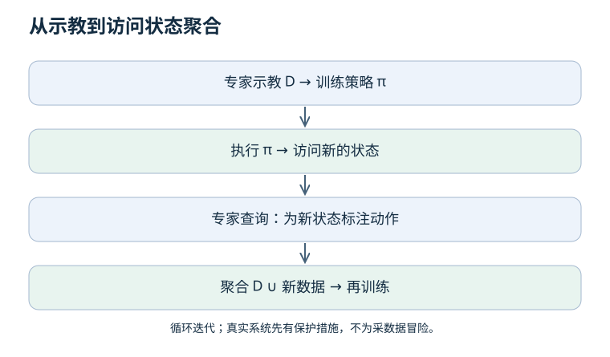
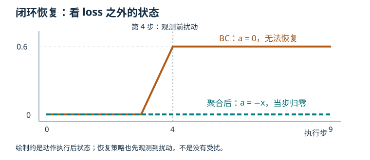

# 05 · 模仿学习：为什么看起来会了，执行却失败？

上一章：[表征与模型](04-representations.md) · 下一章：[生成式策略](06-generative-policies.md)

先修：监督学习、动作合同。目标：理解 BC、数据分布偏移、DAgger，以及离线动作误差与闭环成功的区别。

## 1. BC 学的是条件动作规律

行为克隆（BC）把专家示教转成监督学习：输入观测或历史，预测专家动作。专家数据通常按轨迹保存，因为动作会改变下一时刻的观测。

BC 不等于“只能用 MSE 的确定性网络”。输出可以是连续值、类别分布、混合分布或生成式动作模型；采用什么损失取决于输出的统计模型与训练目标。

| 小知识点 | 必须区分 |
| --- | --- |
| 专家 | 可能是人、控制器或规划器，也会有误差 |
| 观测与状态 | 传感器输入未必包含完整物理状态 |
| 策略 | 从可用信息到动作或动作分布的映射 |
| 开环预测 | 固定数据上比较预测与标签 |
| 闭环执行 | 动作改变环境，再获得新观测 |
| 覆盖 | 训练数据是否含部署时需要处理的情况 |

## 2. 均方误差为什么可能学出危险的平均？

同一观测下，专家一半从左绕障（动作 −1），一半从右绕障（+1）。确定性平方损失的最佳预测是条件均值 0，因为两种误差平均后最小。但 0 可能正对障碍。

这不是“模仿学习无效”，而是输出分布和决策方式不匹配。增加能区分意图的条件、预测多峰分布或使用规划约束，都是不同解决方向；生成式模型也不能保证采样动作安全。

## 3. 一个闭环反例：原数据没有教你恢复

标量系统 x(next) = x + a，目标 x = 0。专家反馈为 a = −x，但演示只在 x = 0 记录，因此所有动作也是 0。数据只能告诉你原点处怎么做，不能辨认离开原点后的斜率。

若训练得到常零策略，外部扰动把 x 推到 0.6 后，它会一直停在 0.6。离线示教误差仍是 0；闭环恢复失败。这就是 [离线实验](README.md#一个不需要-gpu-的实验入口) 要展示的机制。

该反例刻意简化了环境，不是说所有 BC 都会失败。丰富的恢复示教、合适的归纳偏置和部署分布，都可能改变结果。

## 4. DAgger 到底多了哪一步？

核心是让学习者访问状态，再请专家给这些状态标注动作，并与旧数据聚合重新训练。它针对“训练时看到专家状态，部署时看到自己造成的状态”的差异。

完整算法涉及迭代、行为策略/专家混合安排、专家查询与学习假设。我们的单轮标量实验只是 DAgger 思想示例，不是原论文复现。真实机器人上的失败状态不应为了收集数据而无保护执行；先在安全仿真或受控条件中设计查询。

原始资料：[Ross 等，DAgger / no-regret reduction](https://proceedings.mlr.press/v15/ross11a.html)。理论结论有条件，不能转述成“聚合一次数据就解决分布偏移”。

## 5. 示教管线中的隐藏错误

| 检查项 | 失败形式 | 验证办法 |
| --- | --- | --- |
| 时间对齐 | 用动作执行后的图像预测该动作 | 可视化时间戳和延迟 |
| 动作语义 | 绝对位置被当增量执行 | 单步手算、单位与坐标系断言 |
| 数据划分 | 同一轨迹的窗口跨集合 | 先按组划分，再生成窗口 |
| 条件使用 | 输入语言但实际忽略它 | 固定场景替换任务指令作对照 |
| 评估 | 只报训练 MSE 或成功片段 | 报完整尝试数、失败类型与重置规则 |

测试轨迹动作误差更低，成功率一定更高吗？

不一定。关键接触时刻的小误差可能比空闲时的大误差更重要；策略也可能在访问分布变化后失效。需要完整闭环评估。

DAgger 只需要收集学习者动作，不需要专家吗？

不是。这里的监督标签来自专家对学习者访问状态的判断；把学习者自己的错误动作当专家标签，并不构成原算法。

## 6. 实践验收

运行扰动实验，标出扰动时刻、最大偏离和最终偏离。解释为什么聚合后拟合出恢复反馈，再提出一个该线性策略无法解决的非线性或部分可观测反例。
