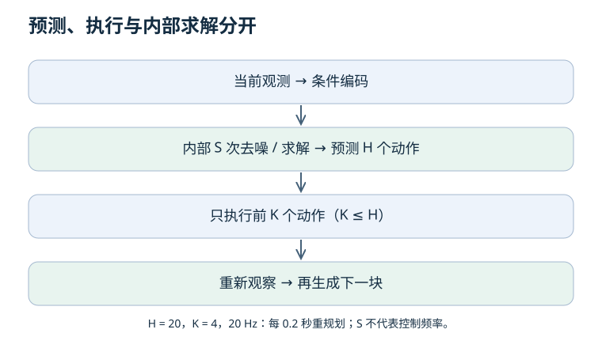
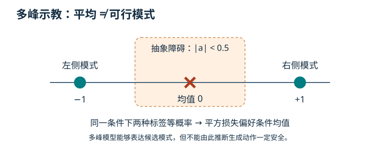

# 06 · 生成式策略：ACT、扩散与动作时间尺度

上一章：[模仿学习](05-imitation.md) · 下一章：[强化学习与评估](07-rl-evaluation.md)

先修：条件分布、BC、多峰动作。目标：区分动作分块与 ACT，理解去噪学习，并避免把采样参数当控制频率。

## 1. 三种时间尺度必须分开

| 符号 | 指什么 | 算例 |
| --- | --- | --- |
| H | 一次预测的动作个数 | 预测 20 个动作 |
| K | 下次重新规划前执行几个动作 | 只执行前 4 个 |
| S | 一次生成内部的去噪/求解步数 | 内部去噪 10 次 |

控制频率为 20 Hz 时，H = 20 覆盖 1 秒，K = 4 对应每 0.2 秒重新规划一次（假设同步执行且推理可及时完成）。S = 10 不是执行 10 个动作，也不是控制频率 10 Hz。必须另外测量推理延迟。

逐步重新查询并对重叠 chunk 做 temporal ensembling 时，动作分块不意味着查询频率下降。开放执行更长 K 可以减少查询，却也增加期间无法响应新观测的风险。

## 2. ACT 不等于任意 Transformer 动作块

原始 ACT 使用条件变分自编码器（CVAE）学习动作序列：训练时后验编码器使用动作序列及关节信息产生潜变量，解码器结合观测与潜变量预测 chunk；测试时不再输入未来专家动作给编码器。

重建项要求动作接近示教，KL 项约束后验与先验的差异。潜变量可表达示教变化，但不能保证学到有语义的“意图旋钮”。原实现测试时使用先验均值，并非必须每次随机采样。

一个仅将视觉特征送入 Transformer 并输出 H 个动作的模型，可以叫动作分块基线，但缺少 CVAE 等组件时不应称为完整 ACT 复现。参见 [ACT 作者项目](https://tonyzhaozh.github.io/aloha/)。

## 3. 扩散策略在学习什么？

前向过程把真实动作序列逐渐混入高斯噪声；网络根据带噪动作、噪声时间与观测条件预测噪声等目标。推理时从噪声开始逐步生成动作，再以滚动方式执行一部分。

记 α(t) = 1−β(t)，ᾱ(t) 为前 t 步 α 的乘积。带噪动作满足：x(t) = √ᾱ(t) x(0) + √(1−ᾱ(t)) ε，其中 ε 是标准高斯噪声。这里 t 是噪声时间，不是机器人采样时刻。

算例：ᾱ(t) = 0.64、干净标量动作为 2、某次 ε = −1，则带噪值为 0.8×2−0.6 = 1。去噪网络需要依赖条件与训练分布；这个等式本身没有教会它完成任务。

## 4. 方差、确定性与实现边界

DDPM 常见反向均值采用预测噪声修正 x(t)。若选择前向过程的后验方差，其值为 β(t)×[1−ᾱ(t−1)]/[1−ᾱ(t)]，约定 ᾱ(0) = 1。固定为 β(t) 也是文献中的另一种方差选择，不能混称为同一个公式。

去掉反向步骤中的新噪声，并不消除初始噪声的随机性，也不会自动变成 DDIM。要重现同一次生成，需要控制初始噪声及后续随机源，并说明算法。训练与推理的调度、时间编号和参数化必须一致。

如果最后一步 ᾱ 仍很大，前向终点尚未接近标准高斯；不能只随意缩短训练噪声调度，再假定从标准高斯开始仍匹配训练。蒸馏或少步求解器需要自己的假设和验证。

原始资料：[DDPM](https://arxiv.org/abs/2006.11239)、[Diffusion Policy 作者项目](https://diffusion-policy.cs.columbia.edu/)。这里解释原理，不提供未经验证的机器人采样器。

## 5. Flow 与 token 策略放在哪？

Flow matching 通常学习指定概率路径下的速度场，再积分生成样本；扩散噪声预测是不同的训练表述，虽然某些条件下存在联系。两者都需核对时间约定、求解器与步数。参见 [Flow Matching 原论文](https://arxiv.org/abs/2210.02747)。

动作 token 将动作离散化后预测类别，需考虑量化分辨率和序列长度；连续动作头避免这类离散化，但仍要满足单位、范围、时序和安全约束。不能仅由架构名推断谁一定更快或更准。

H 从 10 增加到 50，就能更长时间稳定开环执行吗？

不能。更长预测范围可能增加不确定性、训练难度和误差；是否执行那么多步是 K 的选择。需要在扰动、接触和延迟下验证。

扩散策略能表示两条绕障路线，是否代表每个采样都安全？

不是。表达能力与训练质量、条件信息、约束满足是不同问题。必须评估生成动作及闭环行为，必要时采用独立的约束检查。

## 6. 实践验收

手算前向加噪例子，并为一个假想 20 Hz 系统列出 H、K、S、实测推理延迟和失败处理。运行 [多峰动作实验](README.md#一个不需要-gpu-的实验入口)，说明为什么它只解释均值问题，没有训练生成模型。
