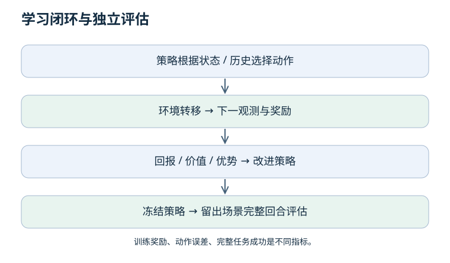

# 07 · 强化学习与评估：从动作标签到长期结果

上一章：[生成式策略](06-generative-policies.md) · 返回：[课程入口](README.md)

先修：条件期望、策略、闭环。目标：理解回报、价值与优势，设计能区分“拟合好了”和“任务成功”的评估。

## 1. 强化学习与监督学习差在哪里？

RL 不必为每个观测提供正确动作，而是利用动作导致的后果来优化长期回报。奖励不是自动正确的任务定义：奖励“碰到物体”可能学会反复碰撞，却没有完成搬运。

| 小知识点 | 定义与边界 |
| --- | --- |
| MDP | 状态、动作、转移、奖励等构成的序贯决策模型 |
| Markov 状态 | 给定当前状态与动作，预测下一步不再需要更早历史 |
| POMDP | 智能体只能获得部分观测，常需历史或信念状态 |
| 策略 π | 根据状态或可用信息选择动作的规则/分布 |
| 回报 G | 从某时刻开始累计的、通常带折扣的奖励 |
| Vπ | 按策略行动时，从状态出发的期望回报 |
| Qπ | 先在状态执行指定动作，再按策略行动的期望回报 |
| 优势 Aπ | Qπ−Vπ，动作相对该状态平均水平的好坏 |

这些期望依赖策略、环境和回报定义；价值不是状态固有不变的分数。

## 2. 回报、Bellman 关系与 bootstrap 算例

奖励序列为 [1, 0, 2]，折扣 γ = 0.9，则起点回报为 1 + 0.9×0 + 0.9²×2 = 2.62。折扣改变了对远期收益的权重，也影响任务建模。

Bellman 关系把长期价值分解为即时奖励与下一状态价值的期望。一次 TD 目标可以写成 r + γV(next)，它用当前价值估计代替尚未观察到的完整未来，这叫 bootstrap。

例：r = 1、V(next) = 2、γ = 0.9，非终止转移目标为 2.8。如果任务真正结束且没有后续回报，目标为 1。把两者混淆会系统性改变学习目标。

## 3. 终止不等于截断

任务定义中的结束（如成功或不可恢复失败）与采样器因时间预算停止记录不是同一个概念。对于继续性任务的人工截断，通常仍需从正确的最终观测 bootstrap；若有限时域本就是任务定义，则应按该定义处理，并在需要时把剩余时间纳入状态。

不要把自动 reset 后的新回合首帧误当上一回合的 next state。写测试覆盖正常转移、真正终止、时间截断三种情况。

## 4. 策略梯度、PPO 与离线 RL

策略梯度提高带来较高估计回报的动作概率，降低较差动作的相对概率。优势估计提供比较基准，但自身也有方差与偏差。

PPO 的裁剪目标限制某些样本上的策略概率比对目标的影响；它不是硬性保证所有状态的策略变化受限，也不是安全控制器。不要因为算法常用就忽略奖励、观测和动作定义。

离线 RL 从固定交互数据学习长期价值；它不等于 BC。对数据未覆盖动作的价值外推可能过高，算法需要处理覆盖和分布外动作问题。混合 BC 与 RL 也必须报告各阶段的数据、预算和评价方式。

### 世界模型为什么既有用又容易误导？

世界模型预测动作之后的状态、观测、奖励或其潜在表征，可以支持规划与想象训练。但预测视频逼真不证明接触力、可执行动作或因果响应正确。

即使一步预测误差很小，把自己的预测连续作为下一步输入也可能使误差累积。规划器还可能利用模型的漏洞，选择真实环境中无效的动作。需要按预测步长、动作干预、未见场景与实际闭环效果分别评估，不能只用重建图像指标替代任务成功。

入门原始课程：[Spinning Up 的 RL 定义](https://spinningup.openai.com/en/latest/spinningup/rl_intro.html)。

## 5. 从“看起来不错”到可信证据

| 证据层级 | 可以支持什么 | 不能单独支持什么 |
| --- | --- | --- |
| 单元测试与梯度检查 | 局部实现符合预期 | 任务成功 |
| 离线留出集误差 | 指定数据分布上的预测表现 | 闭环稳定 |
| 仿真完整回合 | 指定仿真条件下的任务表现 | 真机安全与泛化 |
| 受控真机重复实验 | 报告条件下的物理表现 | 任意环境可靠性 |
| 公平消融与重复试验 | 改动与结果之间的证据 | 所有场景的普适因果结论 |

搬运任务应明确抓取、移动、放置、释放的完成条件；短暂抬起或一段好看的轨迹不等于完整成功。对照实验固定数据、重置、控制器、预算和测试场景，避免把额外数据收益算成方法收益。

## 6. 自测与结业实践

10 次成功 8 次，与 100 次成功 80 次，证据一样强吗？

点估计都是 80%，但样本不确定性不同；回合之间还可能相关。应报告分母、种子、场景分组与不确定性，而不是仅比较百分比。

新方法比旧方法多训练十倍，成功率提高，可以证明结构更好吗？

不能隔离结构贡献。至少需要预算匹配对照，并解释训练成本与性能权衡。还应保持测试协议一致。

选择一个 [工程闭环](../pipelines/README_CN.md)，提交一页实验合同：观测、动作、奖励或标签、数据划分、训练预算、成功判据、失败分类、测试次数和复现方式。先完成简单基线，再提出改动；把未验证部分明确写出来。
