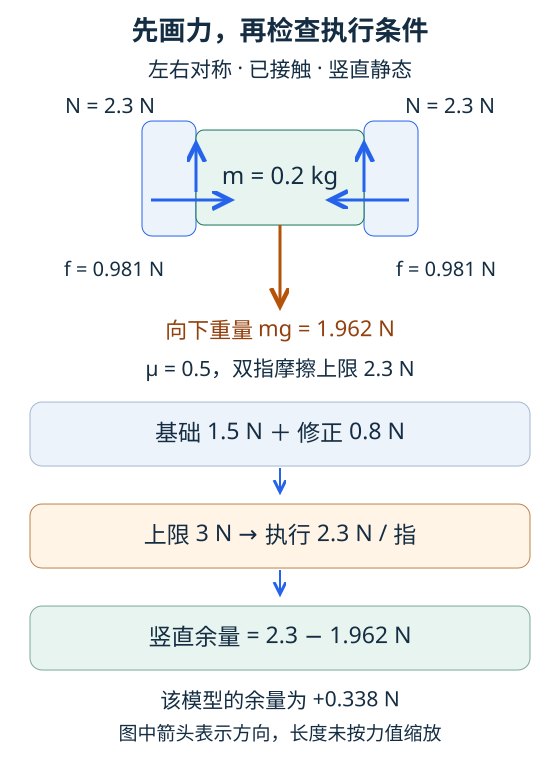

# 08 · 接触、重定向与残差修正

上一章：[强化学习与评估](07-rl-evaluation.md) · 返回：[课程入口](README.md)

先修：坐标系、力与力矩、反馈控制、模仿学习。学完应能画出人手示范到机器人执行的链路，手算一个双指持物条件，并说明修正信号加在哪个变量上。

本课与前沿阅读更新于 **2026-11-14**。论文映射依据公开摘要、作者页面及已注明的原始资料；教学模型使用下文明确给出的假设。

## 1. 把一条人手示范拆成四层

想象人手拿起一个杯子。你从视频恢复了手指关键点，随后让机器人指尖尽量靠近这些位置。接下来还要检查接触位置、机器人可施加的力，以及执行后物体的运动。

| 层 | 输入与输出 | 最小检查 |
| --- | --- | --- |
| 示范恢复 | 视频或动作捕捉 → 人手姿态、物体状态、时间序列 | 单位、坐标系、遮挡、同步误差 |
| 几何重定向 | 人手与物体参考 → 机器人关节或末端参考 | 指尖对应、运动学、关节限位、碰撞 |
| 控制与接触 | 参考和反馈 → 电机命令 → 接触力 | 动作单位、执行器上限、摩擦、力矩平衡 |
| 数据与策略学习 | 执行轨迹 → 策略训练与留出评估 | 失败回合、覆盖、数据隔离、完整任务判据 |

例如，指尖位置误差很小，仍可能把接触点放在物体边缘，或者要求电机持续输出超过上限的力。把失败定位到具体层，才能决定是改对应关系、改控制器，还是补充训练数据。

人手与机器人手的指长不同，需要明确目标点如何缩放、怎样对齐掌坐标，以及哪些手指互相对应。最小化原始指尖距离的优化器只会解决你实际写入的目标和约束。[回到坐标与 IK 图解](../knowledge-atlas/robot-kinematics/index.md)。

## 2. 接触力先从法向与切向分量学起

法向力沿接触面法线压入物体，切向力沿接触面抵抗相对滑动。采用理想库仑静摩擦时，接触的切向力大小受法向力约束。

$$
\lVert f_t\rVert \leq \mu N,\qquad N\geq0.
$$

这里 N 是法向力，单位为牛顿；μ 是无量纲静摩擦系数。等号给出摩擦边界，实际静摩擦力由平衡需求决定。若一个接触可以提供 2 N 切向力，而当前只需 1 N 来平衡，实际需要的就是 1 N。

三维中的允许接触力形成摩擦锥。再把接触点到物体质心的力臂考虑进去，力还会产生力矩。抓持评估因此需要接触位置、力方向和物体所受外力共同参与。[Modern Robotics 接触与操作课程](https://modernrobotics.northwestern.edu/chapters/chapter12/)。

## 3. 手算双指静态持物

采用两个相对的竖直接触面，物体与接触左右对称，质心居中，接触已经建立。两个手指的法向力都为 N，执行器理想地实现该力。物体静止，外力只有重力，取重力加速度为 9.81 m/s²。

左右水平法向力抵消，两个接触各承担一半重量。每指需要的向上摩擦力为 mg/2。双指可提供的向上摩擦总上限与余量为

$$
\begin{aligned}
C&=2\mu N,\\
W&=mg,\\
M&=C-W.
\end{aligned}
$$

| 量 | 含义 | 单位 |
| --- | --- | --- |
| m | 物体质量 | kg |
| W | 物体重量 | N |
| N | 单个手指的接触法向力 | N |
| C | 两指向上静摩擦能力的总上限 | N |
| M | 本模型的竖直力平衡余量 | N |

若 m = 0.2 kg、μ = 0.5、每指 N = 1.5 N，重量为 1.962 N，摩擦能力为 1.5 N，余量为 −0.462 N。所需的最小单指法向力是 1.962 N。质量用 kg 表示，重量用 N 表示。同一物体的质量保持不变，重量随当地重力加速度变化。

μ 为正时，所需最小单指法向力满足

$$
N_{\mathrm{required}}=\frac{mg}{2\mu}.
$$

μ = 0 且质量为正时，本模型中没有有限的法向力能够提供向上摩擦。交互界面对此显示文字说明，并把导出记录中的 requiredNormal 设为空值。

M = 0 表示刚好位于摩擦边界。M > 0 给出模型内的竖直力余量。真实抓持还需要验证质心偏置引起的力矩、接触是否保持、物体形变、动态扰动、传感与执行误差。

自测一：每指 N = 3 N、μ = 0.5、m = 0.2 kg，实际向上摩擦力应该各是多少？

每指的静摩擦上限为 1.5 N。静止平衡时，两指各需要提供 0.981 N，合计抵消 1.962 N 重量。能力总上限为 3 N，余量为 1.038 N。上限随 N 增加，静止平衡所需的力仍由重量决定。

## 4. 残差的作用对象与单位

残差修正需要一个基础输出和一个定义明确的修正量。若基础动作采用关节位置，修正量应采用相容的关节位置单位。若基础输出为关节力矩，修正量应采用相同力矩单位。本课的修正对象是**单指法向力命令**。

设基础命令为 N_base，修正量为 ΔN，修正比例 α 在 0 到 1 之间，单指执行上限为 N_max。计算先相加得到请求力 N_req，再限幅得到执行力 N_exec。

$$
\begin{aligned}
N_{\mathrm{req}}&=N_{\mathrm{base}}+\alpha\Delta N,\\
N_{\mathrm{exec}}&=\operatorname{clip}(N_{\mathrm{req}},0,N_{\mathrm{max}}).
\end{aligned}
$$

最终用 N_exec 计算 C 与 M。无残差基线同样经过 0 到 N_max 的限幅，保证两个配置遵守相同的执行条件。

| 默认算例 | 单指法向力 | 摩擦能力 | 竖直余量 |
| --- | --- | --- | --- |
| α = 0，基础命令 1.5 N | 1.5 N | 1.5 N | −0.462 N |
| α = 1，ΔN = 0.8 N，上限 3 N | 2.3 N | 2.3 N | +0.338 N |
| 同样请求 2.3 N，上限改为 1.8 N | 1.8 N | 1.8 N | −0.162 N |

最后一行中继续增大正残差，执行力仍受 1.8 N 上限约束。负残差会降低请求力，请求低于零时执行力为零。真实系统还需检查物体允许的压力、关节力矩、控制带宽和延迟。

经典残差强化学习把传统控制输出与学习得到的修正相加。本交互中的 ΔN 由学习者手动设定，便于隔离加法与限幅的数值作用。[Residual Reinforcement Learning for Robot Control](https://arxiv.org/abs/1812.03201)。

## 5. 把新论文放回同一条学习链路

阅读时先标出被修改的变量，再找训练数据、控制输入与评价协议。下表是贡献位置的学习索引。

| 工作 | 主要改动位置 | 读论文时要追问 |
| --- | --- | --- |
| GRASP | 物理仿真中的控制轨迹优化与滚动规划 | 接触动力学、示范时长和跟踪目标怎样进入优化？ |
| DexSeed | 人手交互重定向、扩增与机器人示范生成 | 手臂参考、手指控制、成功筛选和 VLA 训练数据如何连接？ |
| RFS | 预训练流策略的动作残差与潜在噪声分布 | 两个修正分支怎样分工，怎样评估各自贡献？ |
| AdaDexTrack | 参考轨迹、物体隐表示与位置目标的反馈修正 | 每个接口如何影响追踪，修正是否依赖当前机器人状态？ |
| GUARD | 生成动作过程中的 Q 函数梯度引导 | 异常评分和任务奖励如何构成引导信号？ |
| DexRemo | 带指尖力感知的手平台、观测融合与任务评测 | 力以哪个坐标系表达，怎样隔离力观测的收益？ |
| TactileLab | 切向运动与接触深度的触觉仿真表征 | 这些信号如何与真实触觉图像对齐，误差怎样影响策略？ |

原始资料依次为 [GRASP](https://arxiv.org/abs/2611.05754)、[DexSeed](https://arxiv.org/abs/2611.14092)、[RFS](https://arxiv.org/abs/2602.01789)、[AdaDexTrack](https://arxiv.org/abs/2610.33852)、[GUARD](https://arxiv.org/abs/2611.10343)、[DexRemo](https://arxiv.org/abs/2611.15981)、[TactileLab](https://arxiv.org/abs/2611.07881)。更多检索记录见 [Paper Analysis 论文库](https://github.com/Dld0621/Embodied-AI-Paper-Analysis)。

这些工作各自选择了不同的作用接口。复现时应抄清楚公式的对象、单位、时间索引和训练条件，再设计共同测试集上的比较。

自测二：读到“残差”，应立即记录哪三个问题？

先记录基础输出是什么，再记录修正量加在哪个变量、采用什么单位，最后记录相加之后由哪些限位和反馈环节执行。以本课为例，基础输出为单指法向力命令，修正为牛顿单位的 ΔN，经过 0 到 N_max 限幅后才用于计算接触承载能力。

遇到潜在变量修正或 Q 梯度引导时，要写出对应的潜在空间或生成过程接口，随后检查它怎样产生最终电机命令。

## 6. 实践验收

打开 [接触与残差交互](../learning-lab-cn.md#contact)。按顺序完成三个配置，先手算再操作，最后导出记录。

1. 保持默认质量和摩擦系数，对比 α = 0 与 α = 1，核对 −0.462 N 和 +0.338 N 两个余量。
2. 把每指上限改为 1.8 N，观察请求力和执行力，写出正残差增大后的余量上界。
3. 把 μ 改为零，再恢复并改变质量，解释无有限解的条件和所需法向力的变化。

提交一页实验卡，包含假设、参数及单位、手算、导出数据、一个模型外的失败条件。进一步进入仿真时，固定物体、初始状态和控制预算，对比有无修正的配置；按接触建立、抬起、运输、放置、释放分别记录结果，并保留失败回合。

后续阅读 [接触与摩擦图解](../knowledge-atlas/robot-contact-friction/index.md)、[力与柔顺控制](../knowledge-atlas/system-force-compliance/index.md) 和 [评估标准](../assessment-cn.md)。
