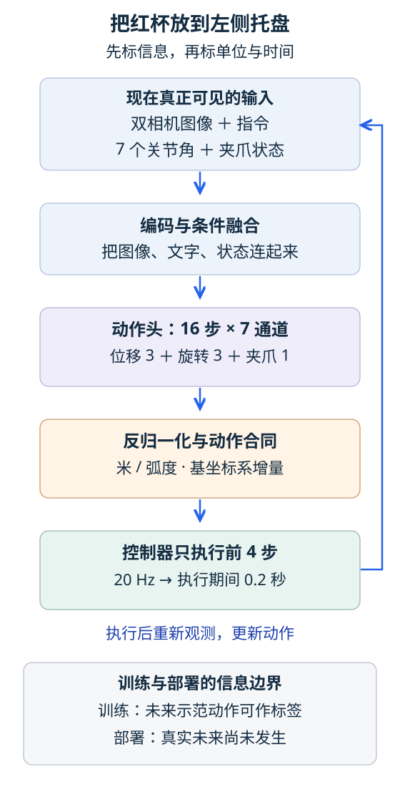

# 09 · VLA：从图像和指令到可检查的动作闭环

**名词太多时先看：** [VLA 十维概念地图](../31-vla-concept-map.md)，再用[Token 与 Attention 数值实验](../32-vla-attention-lab.md)区分参数、特征和注意力权重。

上一章：[接触、重定向与残差修正](08-contact-retargeting.md) · 返回：[课程入口](README.md)

先修：张量与 Transformer、模仿学习、生成式策略、坐标系和反馈控制。学完应能画出 VLA 的输入输出、手算动作反归一化与时间预算，并设计能揭示语言捷径的闭环实验。

**更新于 2026-11-15。** 本课用明确假设的教学机器人解释系统；具体模型的结构与公开状态见[一手来源研究导读](../30-vla-research-guide.md)。教学数值不是某款机器人或论文的实测结果。

## 1. 先做一个任务：把红杯放到左侧托盘

桌上同时有红杯、蓝杯和托盘。固定相机与腕部相机提供图像；编码后的指令指定目标；关节传感器说明机器人当前在哪里。策略给出一段动作，控制器执行其中一小段，再观察杯子有没有抓住。一次输出很长的“正确计划”，仍可能因为杯子滑动而失败。

VLA 是 Vision-Language-Action，即**视觉、语言与动作相联系的策略模型**。VLM 提供图文表征或推理能力，机器人数据把这些表征与动作关联。不同实现可以使用不同骨干和动作头；有些接收机器人状态、历史图像或触觉，有些不接收。判断一个系统要看真实输入、训练目标与执行接口，不能只看名称。

把“红杯”换成“蓝杯”，同一场景中的目标动作应随之改变。只要训练场景里总是红杯在前，策略就可能用位置捷径获得很低的训练损失，却没有学会依照颜色选物体。

## 2. 五个输入输出，逐个说明尺寸

下表是一套**本课自定义合同**，并非 OpenVLA、π₀ 或 SmolVLA 的通用 API。B = 2 表示同一批两个独立训练样本；V = 2 是相机数量；H = 16 是预测动作步数。运行机器人时 B 常为 1，但要查具体实现。

| 变量 | 教学尺寸 | 每个轴或元素代表什么 |
| --- | --- | --- |
| RGB 图像 | `[B,V,3,224,224]` | 批、相机、颜色通道、高、宽；采集时间必须记录 |
| 指令 token | `[B,L]` | L 是批内填充后的文本长度；另有 attention mask |
| 本体状态 | `[B,8]` | 按固定顺序排列的 7 个关节角与 1 个夹爪状态 |
| 动作目标 | `[B,H,7]` | 16 步，每步 3 个位移、3 个旋转分量、1 个夹爪目标 |
| 有效步 mask | `[B,H]` | 回合结尾不足 16 步时，填充部分不计入训练损失 |

图像如何缩放、裁剪和归一化，必须使用 checkpoint 对应的处理器。把红蓝通道弄反、错误地翻转腕部图像、把两台相机的顺序交换，都可能改变条件信息。图像分辨率相同，也不意味着处理流程相同。

**本课动作语义：**位移用机器人基坐标系下的米表示；旋转增量用同一基坐标系的旋转向量、单位为弧度；夹爪是绝对开合比例，0 为闭合、1 为张开。控制器以约定的旋转合成顺序解释旋转向量。本体关节角输入与末端动作输出属于两个不同空间，需要经过具体机器人控制器完成转换。

实际部署还要写明动作是相对当前测量状态、预测开始状态还是前一个目标，以及位移对应哪个控制时间间隔。详见[动作表示与 token 化](../24-action-representation-and-tokenization.md)。

## 3. 图像与文字如何进入动作头？

先把每张图像编码为视觉 token，把文字编码为语言 token，再用注意力或其他条件模块形成上下文。状态可能被投影为 token，也可能通过独立通道输入动作专家。**动作专家**指专门生成机器人动作的网络部分，不是某个人的示范。

可以把 token 想成带内容的向量，但不应把“有注意力”直接解释为“已经理解指令”。注意力连接提供信息交换的路径，是否依赖任务要求的信号需要用实验判断。[SmolVLA 的官方架构说明](https://huggingface.co/blog/smolvla)给出了图像、指令、状态和流匹配动作专家的一个具体实例。

同一个几何场景，对“拿红杯”和“拿蓝杯”应该产生不同的目标；同一条指令，对杯子左右互换的场景也应改变到达方向。因此视觉条件与语言条件都要变化，不能让其中一个永远预测另一个。

## 4. 四类动作生成方法分别学什么？

| 方法 | 训练时预测什么 | 推理时如何得到动作 | 要排查的问题 |
| --- | --- | --- | --- |
| 离散 token | 动作编码后的离散符号，常用交叉熵 | 生成符号，再解码为连续量 | 分箱/压缩误差、符号顺序、串行延迟 |
| 连续回归 | 一个动作或整个动作块，常用 L1/MSE | 一次前向直接输出连续量 | 单一确定性输出遗漏多峰、不同单位权重失衡 |
| 扩散 | 依噪声日程预测噪声、干净动作或其他参数化 | 根据所用采样器逐步去噪 | 步数、噪声日程、动作 mask 与计算预算 |
| 流匹配 | 条件向量场 | 从噪声出发，按约定方向积分 | 时间方向、积分步长、训练与采样约定一致性 |

原始 [OpenVLA](https://arxiv.org/abs/2406.09246)使用离散动作 token；[OpenVLA-OFT](https://openvla-oft.github.io/)组合并行解码、连续动作块与 L1 回归；[π₀](https://arxiv.org/abs/2410.24164)使用流匹配动作生成。这些路线可能复用预训练表征，但训练标签、损失与推理接口不同。

以本课选用的“噪声到动作”线性路径为例，A 是目标动作块，ε 是同形状噪声，τ 在 0 到 1 之间。τ 是**生成过程的插值时间**，不是机器人运行了多少秒。

$$
\begin{aligned}
x_\tau&=(1-\tau)\epsilon+\tau A,\\
u_\tau&=A-\epsilon.
\end{aligned}
$$

网络根据带噪动作、τ 与观测条件预测 u。生成时从 τ = 0 的噪声积分到 τ = 1。其他论文可能采用反向时间或不同路径，照搬代码前必须核对符号。流匹配并不天然保证比所有扩散采样器更快；要在相同质量、步数、硬件和完整链路下测量。[回到生成式策略](06-generative-policies.md)。

## 5. 训练中的“答案”从哪里来？

机器人示范提供动作监督。文字描述、网络图文数据、人类视频可以提供其他学习信号；一段人类视频本身通常没有目标机器人电机命令，需要另行建立动作监督或设计不依赖这些标签的训练目标。不要把视觉可见的人手姿态直接当作机器人动作真值。

一次训练更新可以拆成：读取已对齐的观测与未来动作 → 用训练集统计量归一化 → 组成带 mask 的批次 → 前向得到预测 → 按有效步计算损失 → 反传 → 更新选定参数。回合尾部 padding、机器人自由度 padding、相机缺失应分别记录，不能混成一个含义不明的 mask。

例如连续回归的每步误差 e 是 7 个通道绝对误差的平均，m 表示动作步是否有效：

$$
\begin{aligned}
e_{b,h}&=\frac{1}{7}\sum_{d=1}^{7}|\hat A_{b,h,d}-A_{b,h,d}|,\\
\mathcal L&=\frac{\sum_{b,h}m_{b,h}e_{b,h}}{\sum_{b,h}m_{b,h}}.
\end{aligned}
$$

这里只讨论有效步非空、所有通道都有效的教学批次。混合机器人或多种动作量纲时，需要定义通道 mask、尺度与权重。全为 padding 的批次应拒绝或跳过，不能除以零。

## 6. 预训练、微调、LoRA 与强化学习各改什么？

| 阶段/方法 | 发生的改变 | 交付什么证据 |
| --- | --- | --- |
| 图文预训练 | 学视觉、文字及其关联 | 骨干来源、处理器和许可 |
| 机器人预训练 | 让表征与机器人动作/目标关联 | 数据混合、本体、动作合同与训练目标 |
| 目标任务微调 | 用目标机器人数据更新部分或全部参数 | 数据版本、可训练模块、配置、留出结果 |
| LoRA | 在指定权重中学习低秩更新，减少一部分可训练参数 | 插入位置、rank、冻结项、显存与效果实测 |
| RL 或纠正数据迭代 | 用交互反馈、奖励或专家纠正改善策略 | 奖励、环境预算、干预、失败与策略版本 |

LoRA 不是“让任意模型在任意显存里训练”的保证；视觉塔、激活、序列长度、动作头和优化器仍占资源。强化学习也不等于给成功视频重新标一个高分就完成训练。[RL 课程](07-rl-evaluation.md)解释奖励、终止与公平比较；[π*₀.₆ 官方研究](https://www.pi.website/blog/pistar06)是示范、纠正和自主经历共同改进策略的阅读实例。

拆分数据时以完整 episode 为基本单位。测试新物体、新场景、新任务或新操作者时，再按对应实体隔离。归一化统计、阈值、早停和模型选择都只能使用允许的数据划分。相邻帧高度相似，随机拆帧会让测试集过于接近训练集。

## 7. 手算：归一化数字怎样变成一厘米？

设某个位移通道的训练范围为 −0.02 到 +0.02 米，即 −20 到 +20 毫米，线性映射至 −1 到 +1。模型输出 z = 0.5。记 Δa 为训练范围宽度，反变换为

$$
\begin{aligned}
\Delta a&=a_{\max}-a_{\min},\\
a&=a_{\min}+\frac{z+1}{2}\Delta a,\\
a&=0.01\ \mathrm m.
\end{aligned}
$$

本课合同把它解释为一个动作采样间隔的基坐标系位移增量。20 Hz 的动作采样步长是 0.05 秒；若连续每步执行同样的 +0.01 米且理想跟踪，对应平均速度为 +0.2 米/秒。真实控制器仍需满足运动学、碰撞、速度与加速度限制。

如果误把 0.01 当成绝对位置，机器人就会追逐基坐标系的 x = 0.01 米；若把该米制数字按毫米解释，位移又会缩小一千倍。把数组从 7 个数改成 8 个数，不会自动把末端控制变成关节控制。

自测一：一个输出 [0.5, …] 为什么不能直接发送到机械臂？

先核对它是 token、归一化连续量还是物理量，再核对动作空间、轴顺序、单位、坐标系、绝对/增量语义、夹爪方向和控制时间。本例 z = 0.5 对应 +0.01 米的基坐标系增量。还必须由经过验证的控制器把参考转换成该机器人可执行命令。

## 8. 三个时间尺度：预测、执行与重新观测

H 是预测多少步，K 是一次执行多少步，f 是训练与执行合同约定的动作采样频率。本例每条动作占一个采样间隔，控制器内部的电机伺服可以使用另一频率。通常只执行前 K 步，再用新观测预测；H 和 K 不能直接当作每秒推理次数。

$$
\begin{aligned}
T_{\mathrm{horizon}}&=H/f,\\
T_{\mathrm{prefix}}&=K/f.
\end{aligned}
$$

取 H = 16、K = 4、f = 20 Hz：预测覆盖 0.8 秒，每次执行前缀为 0.2 秒。若先完成 100 毫秒推理，再用 200 毫秒执行，且两者完全串行、不计其他开销，一轮是 300 毫秒，约每秒重规划 3.333 次。一轮实际发送 4 个动作，按完整周期计算有效命令发送率为 4/0.3 ≈ 13.333 Hz。20 Hz 是前缀执行期间的动作命令频率；整轮中还存在等待。

把观测采集设为 0 毫秒，第一个动作在 100 毫秒开始，第四个在 250 毫秒开始；因此这四个动作开始执行时，原观测年龄依次为 100、150、200、250 毫秒。第四步结束时为 300 毫秒。观测年龄、单次推理延迟和一轮总时间对应不同的时间起点，不能互换。

异步系统会在执行旧动作时计算新动作，同时处理迟到的结果、已执行前缀和块间衔接。它可以减少等待，但观测仍可能过时；需要时间戳、最大动作年龄、队列规则与受控停止。不能通过把模型结果放进线程，就宣称实现了论文的 [Real-Time Chunking](https://arxiv.org/abs/2506.07339)。

进入[交互实验](../learning-lab-cn.md#vla)，改变动作块长度、执行前缀与推理延迟。逐个记录模型返回频率、控制频率、观测年龄，解释为什么“生成动作更多”与“反馈更及时”之间存在权衡。

## 9. 评测：先证明模型在依照指令做事

| 对照 | 固定什么 | 改变什么 | 主要观察 |
| --- | --- | --- | --- |
| 指令交换 | 同一场景、初始状态与预算 | 红杯 ↔ 蓝杯 | 目标物体是否跟随指令 |
| 位置交换 | 同样物体和指令 | 红蓝杯位置 | 是否依赖固定位置捷径 |
| 同义改写/空指令 | 初始状态 | 语言表达/移除语言 | 语义稳定性与视觉默认策略 |
| 新物体/背景 | 相同评估规则 | 训练未见实体 | 声明对应泛化轴的留出表现 |
| 延迟/扰动 | 任务与动作合同 | 通信延迟、杯子位移 | 反应时间、失败恢复、超时 |

报告完整回合成功数与总回合数、任务定义、种子和不确定性。拾取、离桌、运输、放置、释放分别记录；按阶段定位失败，并保留完整视频和时间对齐日志。离线动作误差、抓起成功率、完整任务成功率分别回答不同问题。

简单教学例：40 个留出回合中，36 次抓住、32 次离桌、28 次运到托盘、24 次正确放置并释放。完整任务成功率是 24/40 = 60%，不能报告成 90%。分任务或分物体的结果还要单独展示，避免总体数字掩盖难点。

自测二：模型 loss 更低，空指令与正确指令的闭环表现却一样，能得出什么？

只能说明该评测下移除指令没有明显改变表现。可能是任务与场景高度相关、模型忽略语言，也可能评测本身没有制造语言不可替代的选择。应增加同场景不同目标、交换指令与交换位置对照，报告样本量和不确定性，再判断语言条件的作用。

## 10. 接上灵巧手：高维动作还需要接触知识

把夹爪改为多指手后，动作维度、接触状态、可行构型与故障类型都会改变。腕部接近成功不代表指尖接触合理；图像中的握姿正确，也可能无法抵抗重量或物体转矩。策略需要匹配本体的数据和动作合同，触觉、力与历史观测是否必要要由任务与对照实验决定。

人手视频可通过姿态恢复、重定向、物理追踪和筛选生成机器人训练轨迹；每一步的误差应保留来源。VLA 可以位于“观测与语言 → 动作参考”这一层，接触控制器或残差模块再负责指定接口的反馈修正。若残差修正的是力矩，不能把它直接相加到关节位置。[回到第 08 课](08-contact-retargeting.md)。

研究导读将 DexSeed 作为示范生成入口，将 GR00T 2 作为视频与动作共同生成的 WAM 对照。前者与后者都不能替代目标手上的动作合同、留出测试和接触验证。

## 11. 实践验收

先运行 `python examples/vla_contract_lab.py --json`，复算单位变换、量化误差、episode 尾部 mask 与语言对照。这个 [NumPy 实验](../../examples/vla_contract_lab.py)使用手工目标 ID 和一维场景，未训练图像或语言模型。

完成一份可以让同学复核的 VLA 实验卡：

1. 画出两个相机、指令、本体状态、动作头与控制器，标注每个输入输出尺寸和动作单位。
2. 用本课参数手算 z = 0.5 的反归一化、H = 16/K = 4 的时域和串行延迟预算，再在[交互实验](../learning-lab-cn.md#vla)中改变一个条件并预测结果。
3. 列出 episode 划分、训练统计量来源、结尾 padding 与 mask 规则。用三个完整回合检查时间同步。
4. 在同一初始场景设计正确指令、交换指令、空指令和物体位置交换对照，写清成功、失败、干预与超时判据。
5. 从[研究导读](../30-vla-research-guide.md)选两条不同动作路线，用输入、训练目标、推理输出、时间预算和公开证据比较，列出尚未核查的问题。

进阶可接[数据组织](../21-vla-dataset-organization.md)、[部署评测](../20-vla-deployment-guide.md)、[VLA 专项](../specializations/vla-zero-to-one-cn.md)与[世界动作模型专项](../specializations/wam-zero-to-one-cn.md)。交互实验验证教学算式与时间关系；真实 checkpoint 的训练和机器人任务表现需要额外实验记录。
